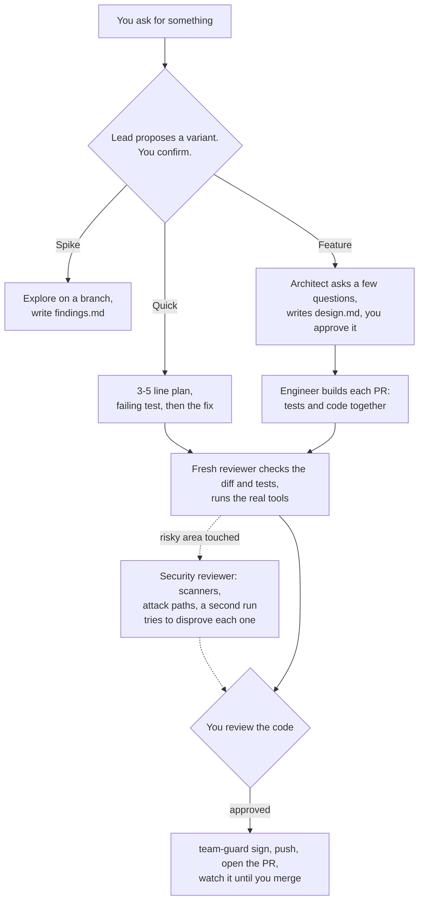

# agentic-workflow

An agent-team workflow for Claude Code and Codex CLI. A lead session proposes a variant, an architect writes one design doc you approve, an engineer builds it with tests and code together, a fresh reviewer checks it and runs the real tools, and you review every PR before anything is pushed.

The workflow is written once in a harness-neutral `core/` and rendered per harness into `dist/`. The aim is less paperwork and more checking against the real tools: reviews and real runs catch bugs, numbered requirements and locks did not.

## Documentation

Guides live in [docs/](./docs/README.md):

- [Workflow](./docs/workflow.md): the three variants, what you approve, and the design doc template.
- [Workspaces](./docs/workspaces.md): set up, sign, and close per-task workspaces.
- [Watch an open PR](./docs/pr-loop.md): how the lead keeps a PR moving until it merges.
- [Harnesses](./docs/harnesses.md): how `build.py` renders the workflow, and how the installers clean up after themselves.

## How it works



| Role | Does |
|---|---|
| **Lead** (the main session) | Proposes the variant, starts each agent, checks test output, drafts the PR description, signs, pushes, watches the PR |
| **Architect** | Asks a few questions, then writes and revises `design.md` |
| **Software engineer** | Writes tests and code together, red then green |
| **Reviewer** | A fresh one each time: checks code and tests against the doc, runs the real tools, writes the risk line |
| **Security reviewer** | Only when a change touches a risky area: runs the installed scanners on the diff, traces untrusted input to risky operations, and reports findings with an attack path after a second run fails to disprove them. Read-only |
| **Doc-writer** | Updates user-facing docs, when they change |
| **Researcher**, **product-owner** | On request, outside the flow |

## Tools

`core/bin/team-guard` keeps what git and the harness don't:

| Command | What it does |
|---|---|
| `team-guard workspace new <feature>` | Creates the workspace dir |
| `team-guard workspace attach <repo>` | Adds a worktree of a repo under `repos/`, on the feature branch |
| `team-guard workspace show` / `list` | Shows one workspace's repos, or all workspaces |
| `team-guard workspace close <feature>` | Archives the files, removes the worktrees, keeps every branch |
| `team-guard workspace-path` | Prints the workspace dir |
| `team-guard sign --base <ref>` | Re-signs the branch's commits with your key before a push |

Workspaces are under `~/.agentic-workflow/work/` (`TEAM_WORKSPACE_ROOT`). See [Workspaces](./docs/workspaces.md).

## Vendored skills

These are [Matt Pocock's skills](https://github.com/mattpocock/skills), MIT licensed, and two skills from [Trail of Bits](https://github.com/trailofbits/skills), CC-BY-SA-4.0 licensed. They are copied into `core/skills/` and pinned at one commit per source, recorded in `core/skills/UPSTREAM.json`.
The copies never auto-update. Each carries its `LICENSE` and a provenance line, and a patched skill is upstream plus a stored patch in `core/skills/patches/`.

| Skill | Status | Used by |
|---|---|---|
| `grilling` | as-is | the lead, to ask numbered questions in chat |
| `writing-for-agents` | as-is | whoever edits `core/` |
| `handoff` | patched | the human, as a slash command |
| `diagnosing-bugs` | patched | the engineer, on a Quick bug fix |
| `tdd` | patched | the engineer |
| `differential-review` | patched | the security reviewer, to review a diff |
| `fp-check` | patched | the security reviewer, to try to disprove one finding |

### Third-party licenses

The Matt Pocock copies are MIT licensed. The two Trail of Bits skills, and our patches to them, are licensed under [CC-BY-SA-4.0](https://creativecommons.org/licenses/by-sa/4.0/): the copies are by Trail of Bits, our changes are marked in each provenance line and kept in `core/skills/patches/`, and each copy carries the upstream `LICENSE`. The Trail of Bits logo in their `assets/` stays only as upstream attribution. This repository has no license of its own yet.

`scripts/vendor-check` reports drift from upstream and changes nothing.

## Optional security scanners

The security reviewer runs whichever of these are installed, and lists the rest under "Not verified" with their install command. Nothing installs them for you.

| Scanner | Finds | When it runs | Install |
|---|---|---|---|
| gitleaks | leaked secrets in the branch's commits | always | `brew install gitleaks` |
| semgrep | code patterns that are usually bugs | always | `brew install semgrep` |
| osv-scanner | vulnerable dependencies | a manifest or lockfile changed | `brew install osv-scanner` |
| govulncheck | vulnerable Go dependencies that the code reaches | Go repos only | `go install golang.org/x/vuln/cmd/govulncheck@latest` |
| zizmor | unsafe CI workflow steps | CI config changed | `brew install zizmor` |

The review report stays in the workspace as `security-review.md`, and the workspace archive keeps it after `workspace close`. It is local, and it never goes into a PR or an issue: the PR gets one neutral line.

## Layout

```text
core/instructions.md      the lead's instructions, with {{placeholders}}
core/roles/*.md           the seven roles, rendered per harness
core/team.json            each role's description and model tier
core/skills/              vendored skills, UPSTREAM.json and patches/
core/bin/team-guard       workspaces and signing
adapters/<harness>/       adapter.json (models, placeholder values), install.sh
build.py                  renders core/ into dist/<harness>/, checks the size limit
dist/<harness>/           committed build output: do not edit
docs/                     the guides above
scripts/                  vendor-check, install-cleanup, remove-old-git-hooks
tests/                    run.sh runs everything
```

## Install

```bash
./build.py claude-code && ./build.py codex     # after editing core/ or an adapter
adapters/claude-code/install.sh                # ~/.claude
adapters/codex/install.sh                      # ~/.codex and ~/.agents
```

Each installer runs the tests first, backs up what it replaces, retires files this build no longer ships (moved to the backup, never deleted), and removes the old `team-guard hook-…` entries from your settings. It leaves a file in place, with a warning, if your settings or hooks still use it. If you used an earlier version, run `scripts/remove-old-git-hooks --scan ~/Code --dry-run` first, then again without `--dry-run`. Details are in [Harnesses](./docs/harnesses.md).

## Known limits

- **Nothing stops an engineer from bending a test.** The reviewer compares every existing test with the base branch and you see every test diff in the PR. If that fails in practice, a separate tester can come back.
- **The Codex instructions share a 32 KiB cap** with project `AGENTS.md` files. The build fails if the rendered instructions pass 16 KB.
- **The security review catches mistakes in our own changes. It is not an audit.** It reads the diff, not the whole system, and how many real bugs it misses is not measured.
- **Workspaces are local.** `team-guard` doesn't push, open PRs or order merges across repos. Don't run several `team-guard` commands against one workspace at once.
- **Squash merges aren't detected.** A squash-merged branch stays `active` in `workspace list` until it goes stale. `workspace close` is the cleanup.
- **The Codex adapter hasn't run a live team yet.** Its files parse and its rules are checked, but the first real run is the remaining check.
