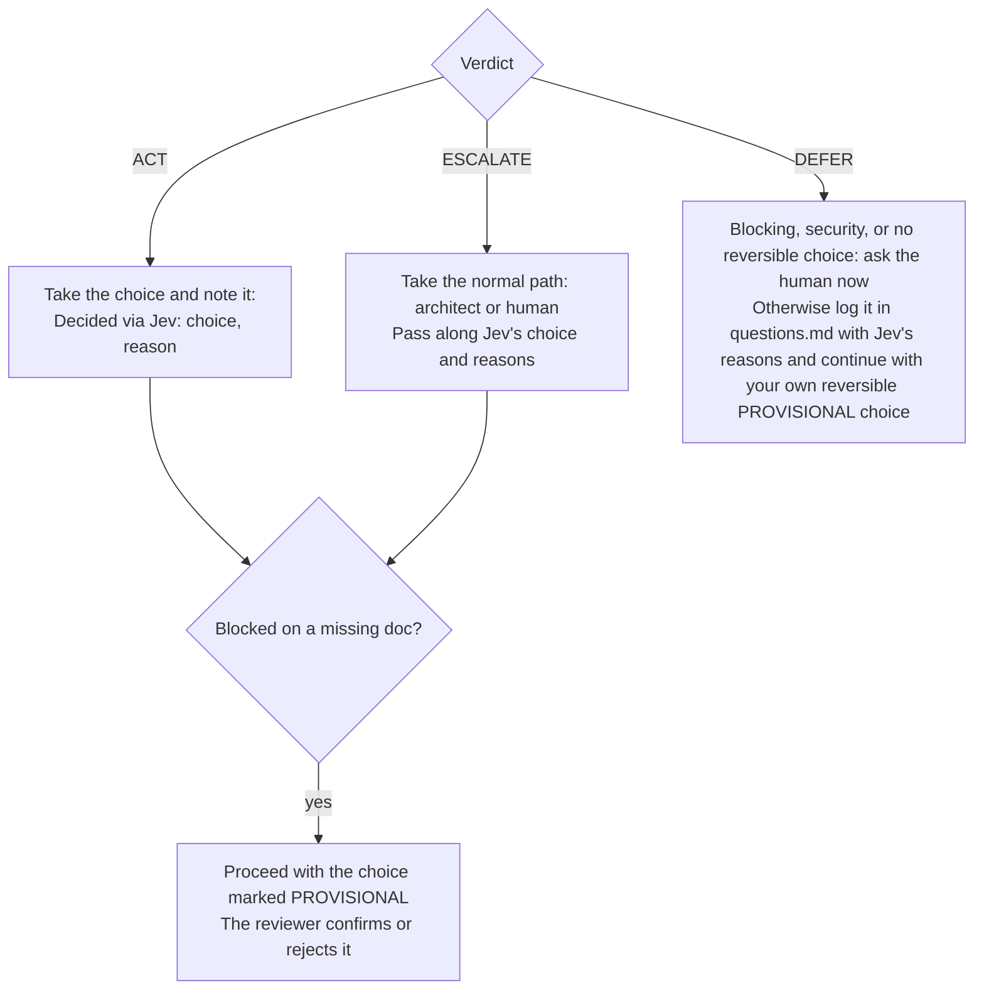
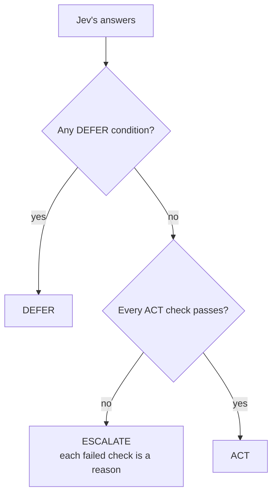

# Decisions with Jev

Use Jev to settle a small, bounded choice between known options in under a second, instead of blocking on a full research pass.

Jev (`typesafe/jev-1.13`) is a decision model, not an LLM.
It picks one of the options you give it and returns probabilities.
It can't explain itself, write code, or see your files.

## Know when to use it

Use Jev for a bounded choice between known options, such as:

- A name.
- Where a helper lives.
- A library pick.
- A provisional answer that unblocks you while a doc is missing.

Never use Jev for:

- Open-ended design.
- Security fixes, or anything about an unfixed vulnerability. Those go to the human.
- Judging work: code, tests, diffs, or whether a task is done.
- Anything you can't describe without PII, customer or tenant data, secrets, or source code.

## Keep sensitive data out

Jev is a third-party service (TypeSafe, via OpenRouter), so anything you send leaves your machine.
Never send:

- **PII:** names of people, emails, usernames, phone numbers, IP addresses.
- **Customer or tenant data:** customer or company names, stack, org, instance, or tenant IDs, `*.grafana.net` URLs, and Salesforce, Zendesk, or support-escalation content.
- **Secrets:** tokens, keys, passwords, connection strings.
- **Source code, diffs, or file contents.** Describe the decision in your own words.

Write the decision abstractly: "a helper used by one component", not the ticket that prompted it.

`ask-jev` checks each request locally for these patterns, and for any name in its `denylist.txt`, and refuses to send a match.
That check is a backstop: it can't recognize every customer or person, so the responsibility stays with you.

> **Note:** The installer creates an empty `denylist.txt` in the skill folder and never overwrites it. Add names that must never reach Jev, one per line. They match case-insensitively, as whole words.

## Ask Jev

Pipe the decision as JSON into `ask-jev`.
In Claude Code it's at `~/.claude/skills/jev-decide/scripts/ask-jev`; in Codex, at `~/.agents/skills/jev-decide/scripts/ask-jev`.

```bash
~/.claude/skills/jev-decide/scripts/ask-jev <<'EOF'
{
  "decision": "Where should the formatDuration() helper live?",
  "context": "Frontend monorepo. Used by exactly one component today; another team might need it next quarter.",
  "constraints": "Moving it later is a cheap refactor. The shared package is public API with deprecation obligations.",
  "options": {
    "colocated": "Keep it next to its only caller until a second caller exists",
    "core_utils": "Put it in the internal core utils module",
    "shared_package": "Put it in the published shared package now"
  },
  "caller": "software-engineer"
}
EOF
```

- `decision` and `options` are required. Give at least two options, each with a one-line description.
- `context`, `constraints`, and `caller` are optional. `caller` only goes in the log.
- Make the options concrete and mutually exclusive. Jev only chooses among what you list.
- Keep the request under about 6,000 characters.

The script adds its own questions: whether the decision touches a public contract, persisted data, security, or other teams, whether the options are clear, and how costly it is to reverse.

## Read the result

```json
{
  "verdict": "ACT",
  "reasons": [],
  "risks": { "public_contract": 0.06, "persisted_data": 0.02, "security_relevant": 0.02, "cross_team": 0.08 },
  "options_clear": 0.76,
  "reversibility": 0.01,
  "reversibility_confidence": 0.93,
  "choice": "colocated",
  "probabilities": { "colocated": 0.84, "core_utils": 0.12, "shared_package": 0.04 },
  "log": "/Users/you/.agentic-workflow/work/payments/jev-decisions.md"
}
```

- Each `risks` value is the probability that the risk is present.
- `reversibility` is a score from 0 to 2: 0 is a trivial local refactor, 1 a coordinated change across teams or components, and 2 a public API, persisted data, or a migration.
- `reasons` names every check that failed. It's empty for `ACT`.
- A `DEFER` result has no `choice` or `probabilities`, so they can't anchor whoever decides.
- The result also carries the request `id`, `model`, and `cost`.

### Act on the verdict



For `ACT`, add a one-line reason to your task notes, since Jev records none.
For a `DEFER` on `security_relevant`, involve the human.
Don't re-ask the same question hoping for `ACT`: answers vary by a few hundredths between runs.

### Know how the verdict is chosen



`DEFER` when any of these holds:

- A risk is clearly present: 0.9 or more.
- The decision is hard to reverse: reversibility 1.5 or more, with confidence of at least 0.6.

`ACT` only when all of these hold:

- Every risk is clearly absent: below 0.2.
- `options_clear` is at least 0.5.
- The chosen option's probability is at least 0.75, or at least 0.6 when the decision is trivially reversible (reversibility 0.2 or less, with confidence of at least 0.6).
- Reversibility is 0.5 or less, with confidence of at least 0.6.

Anything else is `ESCALATE`.
Refused input and API errors also come back as `ESCALATE`, with an `error` field, so a failure never lets you act.

## Find the decision log

Every call is appended to `jev-decisions.md`:

- **Inside a workspace** (the workspace dir or an attached worktree): `jev-decisions.md` in the workspace dir, one log for the whole feature.
- **Outside a workspace:** `jev-decisions.md` in the git directory (`git rev-parse --absolute-git-dir`), per worktree and never committed.

```bash
ask-jev --print-log-path
```

`--print-log-path` prints the resolved path without sending anything.
Pass `--log <path>` to write elsewhere, or `--no-log` to skip logging.

Each entry looks like this:

```markdown
## 2026-09-30T14:23:15 — Where should the formatDuration() helper live?
- caller: software-engineer
- verdict: **ACT** → `colocated`
- probabilities: colocated 0.84, core_utils 0.12, shared_package 0.04
- risks: public_contract 0.06, persisted_data 0.02, security_relevant 0.02, cross_team 0.08
- options_clear: 0.76, reversibility: 0.01 (confidence 0.93)
```

The reviewer reads the log in every review.
They confirm or reject every `PROVISIONAL` decision.
They also flag any `ACT` that was hard to reverse, or that sent PII, customer data, secrets, or code to Jev.

## Configure Jev

| Variable | Purpose |
|---|---|
| `OPENROUTER_API_KEY` | API key. Without it, `ask-jev` uses a macOS Keychain copy, then 1Password. |
| `JEV_OP_REF` | The 1Password reference to read the key from. |
| `JEV_MODEL` | Model ID. Default: `typesafe/jev-1.13`. |
| `JEV_DENYLIST` | Path to the denylist. Default: `denylist.txt` in the skill folder. |

Every threshold at the top of `scripts/ask-jev` has an override, such as `JEV_MIN_CHOICE_PROBABILITY`, `JEV_RISK_CLEAR_BELOW`, and `JEV_RISK_PRESENT_AT`.
Tune them from the decision log, not by guessing.

## Fix common problems

- **`refusing to send: possible ...`:** the request matched a sensitive pattern or a denylisted name. Rewrite it abstractly, or decide without Jev.
- **An `error` from the API:** check your key and network, then take the normal path. The verdict is already `ESCALATE`.
- **`decision is N chars (max 6000)`:** summarize instead of pasting detail.

## Next steps

- See where Jev fits in the steps in [Workflow](./workflow.md).
