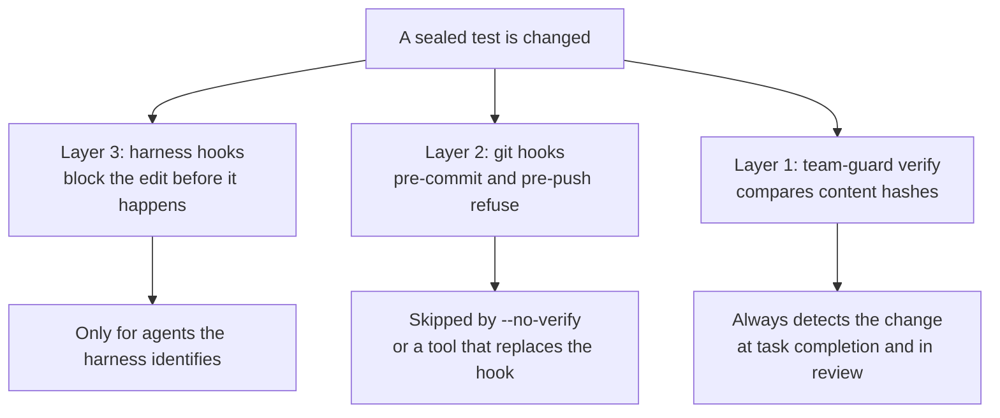
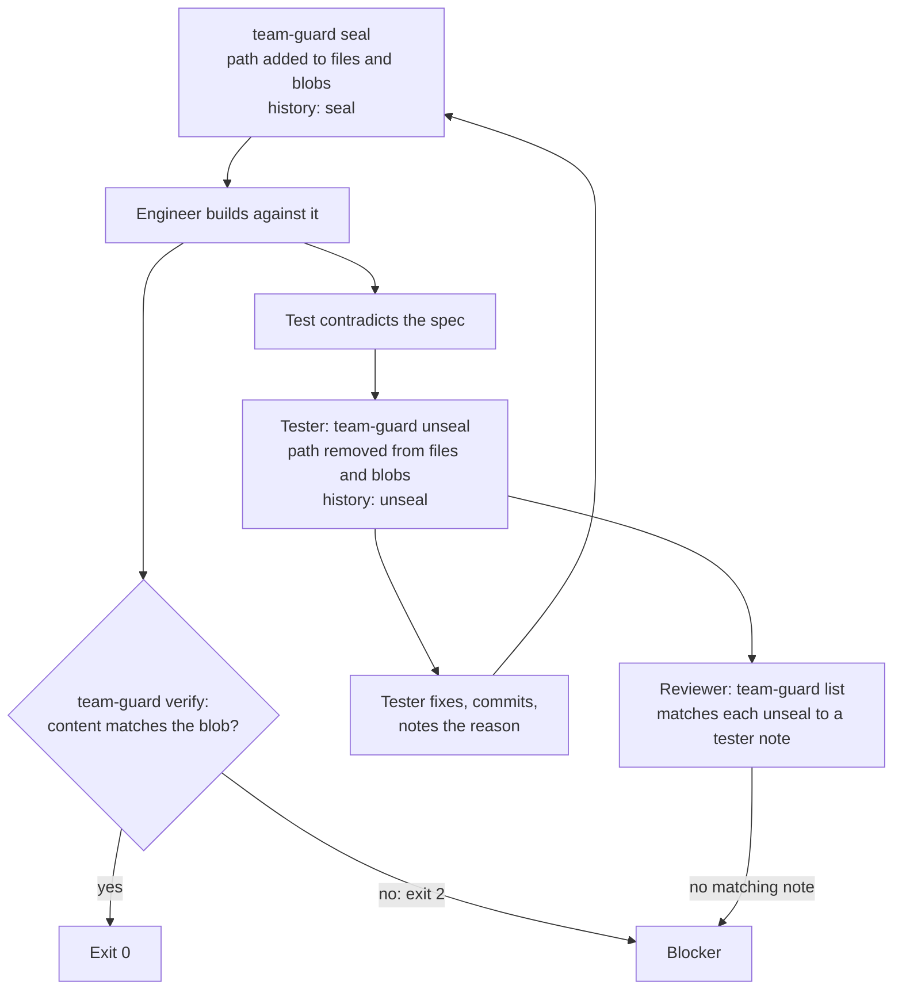

# Guard rails

Sealed tests, three layers of enforcement, mutation testing, design-gate approvals, and a few checks on what the workflow leaves in a repo keep the engineer's definition of done fixed and honest.

## Seal tests

The tester commits the tests, then seals them from inside the attached worktree of the repo under test:

```bash
cd ~/.agentic-workflow/work/payments/repos/api
team-guard seal pkg/payments/charge_test.go pkg/payments/testdata/card.json
# sealed 2 file(s) at 3f9c2a1b7d4e
```

Sealing:

- Refuses a file that isn't tracked or has uncommitted changes. Commit first.
- Records, for each file, the commit it was sealed at and its git blob id (a hash of its content).
- Appends a `seal` entry to the lock history.
- Installs git `pre-commit` and `pre-push` hooks, chaining any hook that was already there.

Seals are per repo, so in a multi-repo feature you seal inside each attached worktree.
`seal`, `unseal`, and `list` refuse to run from the workspace dir itself.

## Check sealed tests

```bash
team-guard verify
```

`verify` compares each sealed file's current content with the blob id recorded when it was sealed.
A changed or deleted file is a violation, and `verify` exits 2:

```text
team-guard: sealed tests were modified:
  api: pkg/payments/charge_test.go (changed since 3f9c2a1b7d4e)
```

Run inside a workspace (the workspace dir or any attached worktree), it checks every attached repo and names the repo on each line.
Because it compares content, a rebase or squash of the sealed commit doesn't trip it.
It also warns when the `pre-commit` hook is missing, for example after another tool replaced it.

## Know the three layers



| Layer | Where it runs | What it does | Gaps |
|---|---|---|---|
| 1. Content check | `team-guard verify`, the `SubagentStop` and `TaskCompleted` hooks (Claude Code), the `SubagentStop` hook (Codex) | Detects any change to a sealed file, by any tool | None: it's the backstop |
| 2. Git hooks | `pre-commit` and `pre-push` in the repo's shared hooks dir | Refuses commits that stage a change to a sealed file, and pushes while a sealed file differs | `--no-verify`, or a tool like `lefthook install` overwriting the hook |
| 3. Harness hooks | `PreToolUse` in Claude Code and Codex | Denies edits to sealed files by any identified agent other than the tester | Shell edits, and agents the harness doesn't identify |

A commit that restores a sealed file to its sealed content isn't refused.
If another tool replaced a hook, `verify` warns you; run `team-guard git-hook install` in that worktree to re-chain it.
`team-guard git-hook status` prints `installed`, `foreign`, or `missing`.

Layer 3 only fires where the harness passes the agent type.
Claude Code passes it inside subagents, but documents no equivalent for agent-team teammates.
Codex fills it for subagents and omits it on the main thread.

The same `PreToolUse` hook denies the engineer reads and searches of the holdout directory, where the engineer is identifiable.

## Read the lock file

Each worktree keeps its own lock at `$(git rev-parse --absolute-git-dir)/team-test-lock.json`.
For an attached worktree that's `<source-repo>/.git/worktrees/<id>/team-test-lock.json`, outside the checkout.
`team-guard list` prints it:

```json
{
  "files": {
    "pkg/payments/charge_test.go": "3f9c2a1b7d4e0c5a9e8f1b2d3c4a5b6e7f8091a2"
  },
  "blobs": {
    "pkg/payments/charge_test.go": "8d2e4f6a1b3c5d7e9f0a2b4c6d8e0f1a3b5c7d9e"
  },
  "history": [
    { "at": "2026-09-30T11:05:00", "action": "seal", "commit": "3f9c2a1b7d4e0c5a9e8f1b2d3c4a5b6e7f8091a2", "files": ["pkg/payments/charge_test.go"] },
    { "at": "2026-09-30T14:20:00", "action": "unseal", "files": ["pkg/payments/charge_test.go"] },
    { "at": "2026-09-30T14:32:00", "action": "seal", "commit": "a7b8c9d0e1f2a3b4c5d6e7f8a9b0c1d2e3f4a5b6", "files": ["pkg/payments/charge_test.go"] }
  ]
}
```

- `files` maps each sealed path to the commit it was sealed at.
- `blobs` maps each sealed path to its git blob id at that commit. `verify` compares against this.
- `history` lists every `seal` and `unseal`, with its time and files. A `seal` entry also records the commit.

Older locks have no `blobs` key.
Their entries keep working: `verify` compares them with the sealed commit instead, until they're resealed.

## Change a sealed test

Only the tester changes a sealed test, and only when the engineer or reviewer shows it contradicts the spec.

```bash
team-guard unseal pkg/payments/charge_test.go
# unsealed 1 file(s); reseal after the fix
# fix the test, commit it, then:
team-guard seal pkg/payments/charge_test.go
```

`unseal` removes the path from `files` and `blobs` and appends an `unseal` entry to the history.
It records no reason, so the tester writes the reason in the task notes.



Nothing stops an engineer from running `team-guard unseal`, but the history records it.
The reviewer treats any unseal without a matching tester note as a blocker.

## Harden tests with mutation testing

Mutation testing is off by default in every variant.
In Full it is opt-in for risk-flagged modules, and then it is sampled and time-boxed.
Python has no supported mutation path.
When it is opted in and the sealed tests pass, the tester runs `mutation-check` from inside the repo:

```bash
mutation-check --base main
```

| Option | Effect |
|---|---|
| `--base <branch>` | Compare against the merge base with this branch. Default: `origin/main`. |
| `--go-only`, `--ts-only` | Mutate only one language. |
| `--dry-run` | Print the free disk, the sampling line and the commands without running them. |
| `--min-free-gb N` | Refuse to start below N GB free (10^9 bytes) in the repo and the temp dir. Default: 20. `0` turns it off. Env: `MUTATION_MIN_FREE_GB`. |
| `--max-concurrency N` | Workers for gremlins (`--workers`) and Stryker (`--concurrency`). Default: 2, minimum 1. Env: `MUTATION_MAX_CONCURRENCY`. |
| `--time-box MIN` | Stop after MIN minutes. Default: 15. `0` turns it off. Env: `MUTATION_TIME_BOX_MIN`. |
| `--sample N` | Mutate at most N changed lines. Default: 50. `0` turns it off. Env: `MUTATION_SAMPLE`. |
| `--seed S` | Choose which lines are sampled. The same seed picks the same lines. Default: 1. |

A flag beats its environment variable, which beats the default.
A value that isn't an integer, or is negative, stops the run with exit 1 before anything starts.
It mutates only files changed since the merge base, skipping tests and generated code.
Go runs through gremlins per changed package, with survivors filtered to changed lines.
TypeScript runs through Stryker's jest runner on the changed files.

```text
Go mutants on changed lines: killed 8, lived 2, not covered 1
mutation score: 73% (killed / (killed + lived + not covered))

Survivors — each is a behavior change no test noticed:
  LIVED       CONDITIONALS_NEGATION        pkg/payments/charge.go:42
  NOT COVERED ARITHMETIC_BASE              pkg/payments/charge.go:88
```

`mutation-check` exits 0 whether or not mutants survive.
It exits 3 when it refuses to start because the repo or the temp dir has too little free disk, and it starts nothing.
It exits 4 when the time box ends the run: it prints the counts so far and `INCOMPLETE: time box of 15 minutes reached`.
A run interrupted by SIGINT, SIGHUP or SIGTERM exits 130, 129 or 143.
For each survivor that matters, the tester either writes a test that kills it, or records why it's equivalent (it can't change observable behavior) or irrelevant.
New tests from this step get sealed too.

Sampling works on changed lines.
When there are more than N changed lines, `mutation-check` prints `sampled N of M changed lines (seed S)`, runs gremlins only for packages that hold a sampled line, and reports at most one Go mutant per sampled line.
For TypeScript it passes Stryker line ranges that cover exactly the sampled lines.
For Go, sampling limits which packages run, not the mutants inside one package, so the time box is what bounds a large package.
Only one tool process runs at a time, in its own process group.
Each run keeps its temp files in `<tmp>/mutation-check-<pid>` and removes them, any `.stryker-tmp` it created, and its tool processes on every exit.
Line coverage is a secondary signal only.

> **Note:** The TypeScript path assumes a jest setup that Stryker's jest runner can discover. Expect to tune it on first use in a large monorepo.

## Keep workflow references out of code

`team-guard refs [--base <ref>]` scans the lines added since the merge base, plus new file names, for citations of workflow artifacts.
Comments, docstrings, test names and file names describe behavior and never cite them.

| Pattern | Finds |
|---|---|
| `criterion-id` | Criterion numbers such as `AC-12` or `test_ac12_creates_file` |
| `section-mark` | Section marks such as `§4` |
| `workflow-file` | Names of planning files such as `contract.md` |
| `addendum` | The word addendum |
| `review-round` | Review rounds such as `round 2` |
| `adr-number` | ADR numbers such as `ADR 0007` |

`team-guard refs` skips deleted and binary files, `docs/**`, `**/*.md`, `**/*.rst`, `**/*.txt`, `dist/**`, and lockfiles and dependency sums (`go.sum`, `package-lock.json`, `pnpm-lock.yaml`, `yarn.lock`, `*.lock`).
It exits 2 when it finds something (one line per line and pattern on stderr, then `team-guard: refs: N finding(s)`), 0 when nothing is found, and 1 for a bad config, an unknown base, or a missing `--base` outside a workspace.
Inside a workspace it scans every attached repo against its recorded base, and prefixes each finding with the repo name.

Point `--config <file>` (or `TEAM_REFS_CONFIG`) at a JSON file to change the scan:

```json
{
  "patterns": [{"name": "ticket", "regex": "TICKET-\\d+"}],
  "disable_patterns": ["section-mark"],
  "exclude": ["vendor/**"]
}
```

`patterns` adds to the built-in set, `disable_patterns` names built-in patterns to drop, and `exclude` replaces the default path skips.
Unknown keys and names are errors, and nothing is scanned.

## Record routing and merge risk

`team-guard routing record` appends what the lead proposes, what the human confirms and how long each step took to `$TEAM_LOG_ROOT/routing-log.jsonl` (default `~/.agentic-workflow/routing-log.jsonl`), and a matching line to `routing.md` in the workspace dir, or in the git directory outside a workspace.
The log is only ever appended to.

```bash
team-guard routing record route --proposed standard --confirmed standard \
  --answer repos=1 --answer files=4-15 --answer persisted=no
team-guard routing record step --step build --seconds 1800
team-guard routing record upgrade --to full --reason "a second repo is needed"
team-guard routing summary --json
```

The `--answer` keys are `repos`, `files`, `contract`, `persisted`, `security`, `cross_team`, `revertible`, `user_visible`, `design_question` and `repro`; an omitted key is stored as `unknown`.
A variant never goes down, and a Spike is never upgraded.
`team-guard routing summary` reports overrides and their direction, upgrades and time per final variant, and counts lines it can't read.

`team-guard risk` computes the merge-risk level and prints the footer line for the PR:

```bash
team-guard risk --feature payments --majors-fixed 1 --packet
# Merge risk: high (advisory) — changes stored data or its format, which a revert may not undo.
```

It reads the routing answers, the changed files and lines in every attached repo, the unseals in the lock history, and the flags `--contract`, `--majors-fixed`, `--holdouts-failed` and `--mutation-skipped`.
An unknown input counts as risky, and a file path can raise the level (a migration, or an auth or security path) but never lower it.
`--packet` adds the rules that fired and every input for the human's review packet.
The level and rule ids go to the routing log unless you pass `--no-log`; the log holds enums and counts, never file names.

## Re-sign the branch

Agents commit unsigned, so the human re-signs the branch once, after the code review and before anything is pushed:

```bash
team-guard sign          # from the workspace dir, or a repo with --base <ref>
```

When the human runs it, `team-guard sign` checks every repo first and refuses a checkout with uncommitted changes to tracked files, a rebase or merge in progress, or a detached HEAD.
It then rebases the branch onto its own base with an amend that signs each commit, checks that every commit is signed and that the trees are unchanged, and restores the branch if anything fails.
It warns when another pre-commit hook runs on every amend.
Without `gpg.ssh.allowedSignersFile` git can't verify an SSH signature, so it says the signatures are present but not verified.

## Run a design gate

The lead runs each design gate with four commands, from the workspace dir or an attached worktree.
Crit runs locally with `-o <workspace>/.crit`, in its own session, with `CRIT_NO_UPDATE_CHECK=1`, `CRIT_PLAN_REVIEW=off` and an empty `CRIT_SHARE_URL`.
The tool never uses Crit's `share`, `push`, `pull` or `--pr`, and never changes Crit's config.
`CRIT_BIN` names the executable (default `crit`).

| Command | What it does |
|---|---|
| `team-guard gate review <gate> [<file>...] [--new] [--no-open]` | Starts a review (or continues the unfinished one), streams Crit's output, and exports the round to `reviews/<gate>-round<N>.json` when it starts and when it ends. It ends with `gate <gate> round <N>: approved=<true or false> comments=<K>` and exits 0 for either verdict. |
| `team-guard gate reply <gate> --file <json> --author <role>` | Posts a JSON array of `{reply_to, body}` entries to the unfinished review, exactly as written, then re-exports the round. It never resolves a thread. |
| `team-guard gate record <gate> [<file>...] (--crit \| --chat "<reply>")` | Appends the approval and the sha256 of each reviewed file to `design-gate.md`. `--crit` uses the files and hashes stored when the review was approved. `--chat` needs the exact reply and works without Crit. |
| `team-guard gate check [<gate>]` | Compares the files with the latest recorded approval (the named gate, or the last one in the file). |

`gate review` starts Crit detached, so it survives if the waiting process is killed.
Run it in the background with the harness's longest background timeout, and if the wait is stopped, re-run it: it continues the same session and round, and `--new` starts a fresh review instead.
An export is never replaced by one with fewer comments, and earlier rounds are never touched, because Crit deletes its data when a review is approved.

`gate review` fails with exit 3, and names the reply that approves the gate, when Crit is unavailable: use the chat fallback.
The literal replies are `approve design`, `approve D1` and `approve D2`, and nothing else counts.
`gate check` exits 0 when the recorded hashes still match, and exit 2 means a file changed or is missing, or nothing is recorded: reopen the gate.
Any other failure exits 1.

The `hook-pretool` hook denies a tester any tool call that reaches `.crit/` or `reviews/`.
Codex's hook matcher doesn't cover reads, and shell reads aren't covered in either harness, so there the rule rests on the spawn prompt and the reviewer.
Making `seal` require a matching gate record is planned.

## Keep the tester out of the inner loop

The Skill denial for `tdd-inner-loop` is enforced on Claude Code where the agent is identifiable (the `hook-pretool` matcher includes `Skill`); it is not enforced on Codex, which has no Skill hook, so there the rule rests on the role prose and `allow_implicit_invocation: false`.

## Check the vendored skills

These are [Matt Pocock's skills](https://github.com/mattpocock/skills), MIT licensed, copied into `core/skills/` and pinned at one commit recorded in `core/skills/UPSTREAM.json`.
The plugin is not installed, and the copies never auto-update, so prompts that run commands can't change under you.
Every copy carries its `LICENSE` and a provenance line naming the source, the commit and whether it was modified.
A patched skill is upstream plus a stored patch in `core/skills/patches/`, which keeps workflow files in the workspace dir and never in a project repo.

The set is `grilling`, `codebase-design`, `writing-for-agents`, `domain-modeling`, `handoff`, `to-questionnaire`, `diagnosing-bugs` and `tdd-inner-loop`.

Run `scripts/vendor-check` to see drift: it compares each copy with upstream at the pin plus its patch (`local drift`) and with a newer ref (`upstream changed`, `upstream removed`, or a `patch conflict`), exits 1 on drift and 2 when it can't run, and never changes anything.
Moving the pin is a person's decision: update the copies and patches, then the pin.

## Watch for `core.hooksPath`

Tools such as Husky set `core.hooksPath`, and git then ignores the hooks in `.git/hooks` where `team-guard` installs its own.
`team-guard verify` prints a warning that names the setting when a repo with sealed files has one and the hook there isn't team-guard's.
Nothing else changes: `team-guard git-hook install` would write into that directory, so `verify` and the reviewer are the remaining checks.

## Next steps

- See where the reviewer runs these checks in [Workflow](./workflow.md#what-the-reviewer-checks).
- See how seals work across repos in [Workspaces](./workspaces.md).
