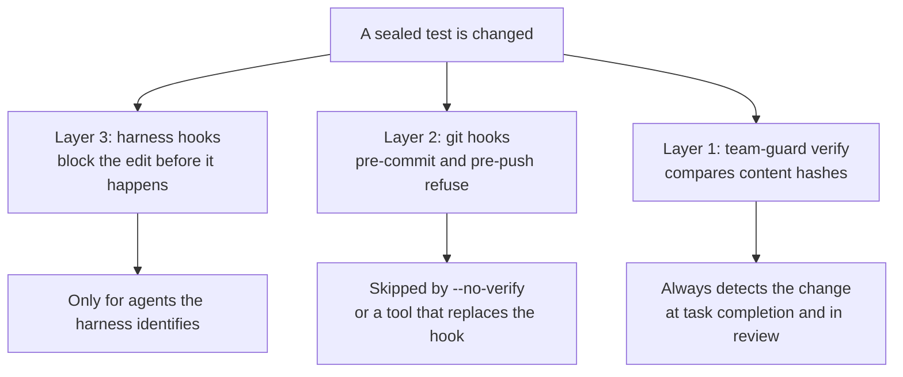
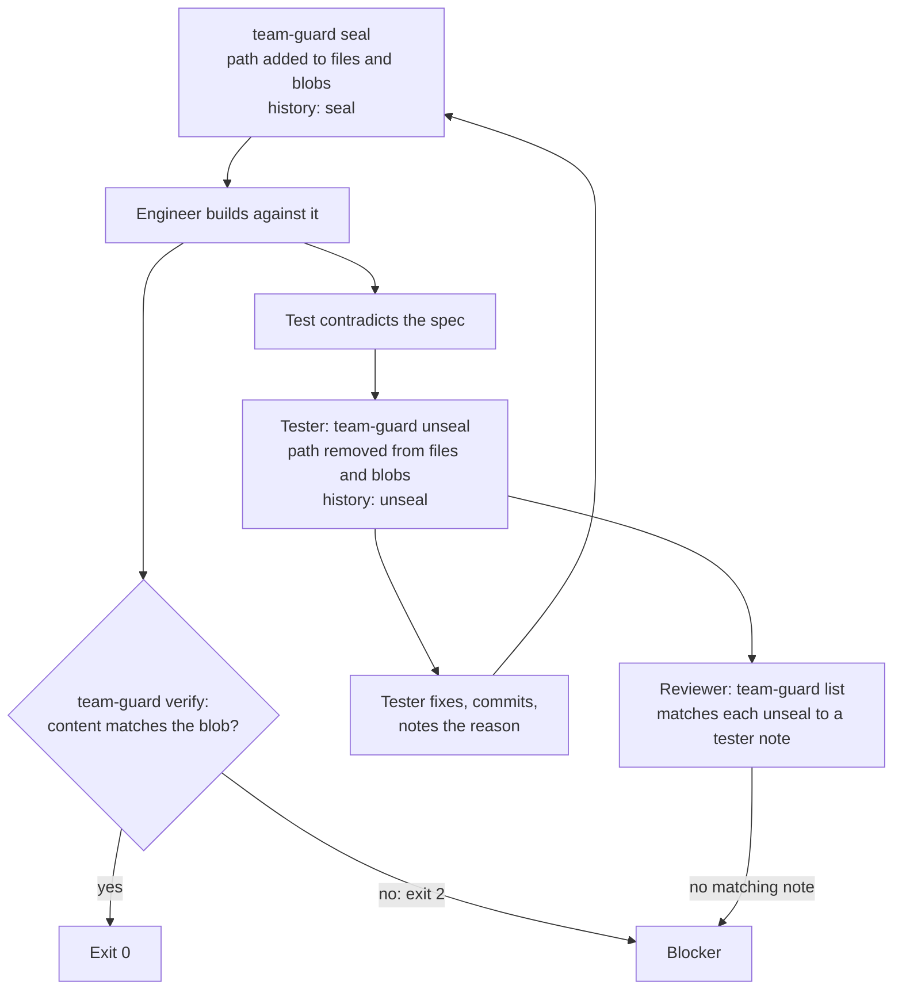

# Guard rails

Sealed tests, three layers of enforcement, and mutation testing keep the engineer's definition of done fixed and honest.

## Seal tests

The tester commits the tests, then seals them from inside the attached worktree of the repo under test:

```bash
cd ~/.agentic-workflow/work/payments/repos/api
team-guard seal pkg/payments/charge_test.go pkg/payments/testdata/card.json
# sealed 2 file(s) at 3f9c2a1b7d4e
```

Sealing:

- Refuses a file that isn't tracked or has uncommitted changes. Commit first.
- Records, for each file, the commit it was sealed at and its git blob id (a hash of its content).
- Appends a `seal` entry to the lock history.
- Installs git `pre-commit` and `pre-push` hooks, chaining any hook that was already there.

Seals are per repo, so in a multi-repo feature you seal inside each attached worktree.
`seal`, `unseal`, and `list` refuse to run from the workspace dir itself.

## Check sealed tests

```bash
team-guard verify
```

`verify` compares each sealed file's current content with the blob id recorded when it was sealed.
A changed or deleted file is a violation, and `verify` exits 2:

```text
team-guard: sealed tests were modified:
  api: pkg/payments/charge_test.go (changed since 3f9c2a1b7d4e)
```

Run inside a workspace (the workspace dir or any attached worktree), it checks every attached repo and names the repo on each line.
Because it compares content, a rebase or squash of the sealed commit doesn't trip it.
It also warns when the `pre-commit` hook is missing, for example after another tool replaced it.

## Know the three layers



| Layer | Where it runs | What it does | Gaps |
|---|---|---|---|
| 1. Content check | `team-guard verify`, the `SubagentStop` and `TaskCompleted` hooks (Claude Code), the `SubagentStop` hook (Codex) | Detects any change to a sealed file, by any tool | None: it's the backstop |
| 2. Git hooks | `pre-commit` and `pre-push` in the repo's shared hooks dir | Refuses commits that stage a change to a sealed file, and pushes while a sealed file differs | `--no-verify`, or a tool like `lefthook install` overwriting the hook |
| 3. Harness hooks | `PreToolUse` in Claude Code and Codex | Denies edits to sealed files by any identified agent other than the tester | Shell edits, and agents the harness doesn't identify |

A commit that restores a sealed file to its sealed content isn't refused.
If another tool replaced a hook, `verify` warns you; run `team-guard git-hook install` in that worktree to re-chain it.
`team-guard git-hook status` prints `installed`, `foreign`, or `missing`.

Layer 3 only fires where the harness passes the agent type.
Claude Code passes it inside subagents, but documents no equivalent for agent-team teammates.
Codex fills it for subagents and omits it on the main thread.

The same `PreToolUse` hook denies the engineer reads and searches of the holdout directory, where the engineer is identifiable.

## Read the lock file

Each worktree keeps its own lock at `$(git rev-parse --absolute-git-dir)/team-test-lock.json`.
For an attached worktree that's `<source-repo>/.git/worktrees/<id>/team-test-lock.json`, outside the checkout.
`team-guard list` prints it:

```json
{
  "files": {
    "pkg/payments/charge_test.go": "3f9c2a1b7d4e0c5a9e8f1b2d3c4a5b6e7f8091a2"
  },
  "blobs": {
    "pkg/payments/charge_test.go": "8d2e4f6a1b3c5d7e9f0a2b4c6d8e0f1a3b5c7d9e"
  },
  "history": [
    { "at": "2026-09-30T11:05:00", "action": "seal", "commit": "3f9c2a1b7d4e0c5a9e8f1b2d3c4a5b6e7f8091a2", "files": ["pkg/payments/charge_test.go"] },
    { "at": "2026-09-30T14:20:00", "action": "unseal", "files": ["pkg/payments/charge_test.go"] },
    { "at": "2026-09-30T14:32:00", "action": "seal", "commit": "a7b8c9d0e1f2a3b4c5d6e7f8a9b0c1d2e3f4a5b6", "files": ["pkg/payments/charge_test.go"] }
  ]
}
```

- `files` maps each sealed path to the commit it was sealed at.
- `blobs` maps each sealed path to its git blob id at that commit. `verify` compares against this.
- `history` lists every `seal` and `unseal`, with its time and files. A `seal` entry also records the commit.

Older locks have no `blobs` key.
Their entries keep working: `verify` compares them with the sealed commit instead, until they're resealed.

## Change a sealed test

Only the tester changes a sealed test, and only when the engineer or reviewer shows it contradicts the spec.

```bash
team-guard unseal pkg/payments/charge_test.go
# unsealed 1 file(s); reseal after the fix
# fix the test, commit it, then:
team-guard seal pkg/payments/charge_test.go
```

`unseal` removes the path from `files` and `blobs` and appends an `unseal` entry to the history.
It records no reason, so the tester writes the reason in the task notes.



Nothing stops an engineer from running `team-guard unseal`, but the history records it.
The reviewer treats any unseal without a matching tester note as a blocker.

## Harden tests with mutation testing

Mutation testing is off by default in every variant.
In Full it is opt-in for risk-flagged modules, and then it is sampled and time-boxed.
Python has no supported mutation path.
When it is opted in and the sealed tests pass, the tester runs `mutation-check` from inside the repo:

```bash
mutation-check --base main
```

| Option | Effect |
|---|---|
| `--base <branch>` | Compare against the merge base with this branch. Default: `origin/main`. |
| `--go-only`, `--ts-only` | Mutate only one language. |
| `--dry-run` | Print the commands without running them. |

It mutates only files changed since the merge base, skipping tests and generated code.
Go runs through gremlins per changed package, with survivors filtered to changed lines.
TypeScript runs through Stryker's jest runner on the changed files.

```text
Go mutants on changed lines: killed 8, lived 2, not covered 1
mutation score: 73% (killed / (killed + lived + not covered))

Survivors — each is a behavior change no test noticed:
  LIVED       CONDITIONALS_NEGATION        pkg/payments/charge.go:42
  NOT COVERED ARITHMETIC_BASE              pkg/payments/charge.go:88
```

`mutation-check` exits 0 whether or not mutants survive.
For each survivor that matters, the tester either writes a test that kills it, or records why it's equivalent (it can't change observable behavior) or irrelevant.
New tests from this step get sealed too.

Sampling and hard limits in `mutation-check` (a free-disk check, capped concurrency, guaranteed cleanup, an enforced time box) are planned and don't exist yet, so the tester samples by hand (one risk-flagged package, or a subset from `--dry-run`) and stops at the time box.
Line coverage is a secondary signal only.

> **Note:** The TypeScript path assumes a jest setup that Stryker's jest runner can discover. Expect to tune it on first use in a large monorepo.

## Next steps

- See where the reviewer runs these checks in [Workflow](./workflow.md#what-the-reviewer-checks).
- See how seals work across repos in [Workspaces](./workspaces.md).
