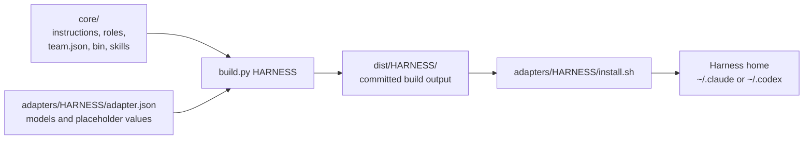
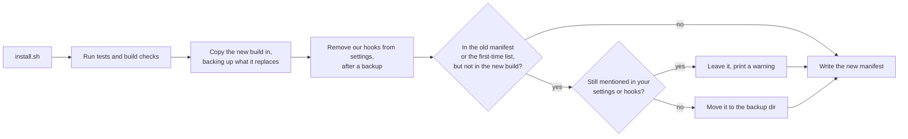

# Harnesses

The workflow is written once in `core/` and rendered for each agent harness, Claude Code and Codex CLI, by `build.py` through an adapter.



## Know what each part supplies

| Part | Supplies |
|---|---|
| `core/instructions.md`, `core/roles/*.md` | The workflow and role prose, with `{{placeholders}}` wherever the harnesses differ. |
| `core/team.json` | Each role's description and model tier: `strong`, `standard`, or `fast`. |
| `core/bin/`, `core/skills/` | `team-guard` and the skills, shared by every harness. |
| `adapters/<harness>/adapter.json` | The `harness` type, the model for each tier, and a value for every placeholder. |

| Tier | Claude Code | Codex CLI |
|---|---|---|
| `strong` | `claude-opus-5-5` | `gpt-6-astra` |
| `standard` | `claude-sonnet-5-5` | `gpt-6-sol` |
| `fast` | `claude-haiku-4-5-20251001` | `gpt-6-luna` |

The Codex adapter also sets a reasoning effort per tier (`efforts`).

## Build

Build one harness per run, from the repo root:

```bash
./build.py claude-code
./build.py codex
./build.py --check claude-code   # exit 1 if dist/claude-code is stale
```

`build.py`:

- Renders `core/instructions.md` into `CLAUDE.md` or `AGENTS.md`, and appends the adapter's optional `instructions_footer`.
- Renders each role from its prose and its `team.json` entry.
- Renders each skill's `SKILL.md`, and copies the skill's other files and `core/bin/` unchanged.
- Fails if a file uses a placeholder the adapter doesn't define.

Role prose in `core/roles/` has no frontmatter; the build generates it from `team.json`:

| Harness | Role file | Generated from `team.json` and the adapter |
|---|---|---|
| Claude Code | `dist/claude-code/agents/<role>.md` | YAML frontmatter with `name`, `model`, and `description`, followed by the prose |
| Codex CLI | `dist/codex/agents/<role>.toml` | `name`, `description`, `model`, and `model_reasoning_effort`, with the prose in `developer_instructions` |

The build parses each TOML file before writing it, so it fails rather than ship a file Codex can't read.

`dist/` is committed so diffs stay readable.
Don't edit it: change `core/` or an adapter, then rebuild.
`tests/run.sh` checks that every `dist/` is up to date. The build also fails if the rendered instructions pass 16 KB, half of Codex's 32 KiB limit.

## Ship the vendored skills

These are [Matt Pocock's skills](https://github.com/mattpocock/skills), MIT licensed, copied into `core/skills/` and pinned at one commit recorded in `core/skills/UPSTREAM.json`.
The plugin is not installed, and the copies never auto-update, so prompts that run commands can't change under you.
Every copy carries its `LICENSE` and a provenance line naming the source, the commit and whether it was modified.
A patched skill is upstream plus a stored patch in `core/skills/patches/`, which keeps workflow files in the workspace dir and never in a project repo.

| Skill | Status | Used by |
|---|---|---|
| `grilling` | as-is | the lead, as the chat way to ask the human numbered questions |
| `writing-for-agents` | as-is | whoever edits `core/` |
| `handoff` | patched | the human, as a slash command; writes `handoff-<slug>.md` in the workspace dir |
| `diagnosing-bugs` | patched | the engineer, on a Quick bug fix |
| `tdd` | patched | software-engineer only |

`build.py` ships only the directories of `core/skills/` that hold a `SKILL.md`, so `UPSTREAM.json` and `patches/` stay behind. It renders each `SKILL.md` with the adapter's vars: `skill_call` and `skill_sigil` say how a skill names another one (Claude Code calls the Skill tool; Codex mentions `$name`).

Run `scripts/vendor-check` to see drift: it compares each copy with upstream at the pin plus its patch (`local drift`) and with a newer ref (`upstream changed`, `upstream removed`, or a `patch conflict`), reports a LICENSE the upstream deleted as `LICENSE: upstream removed`, exits 1 on drift and 2 when it can't run, and never changes anything.
Moving the pin is a person's decision: update the copies and patches, then the pin.

The byte-for-byte checks need a local clone of upstream at the pin. Run the suite with `VENDOR_UPSTREAM_CLONE=<path to a clone of mattpocock/skills at the pin> tests/run.sh`; without it those tests skip with that reason, and nothing touches the network.

## Know what is unverified

On Codex, the engineer loads `$tdd` by mentioning it in its developer instructions. The Codex docs say an explicit `$skill` mention still works when implicit invocation is off, but that loading from developer instructions rather than a user turn is unverified.
If it doesn't load, the lead can put `$tdd` in the engineer's spawn prompt, which is a user turn.

## Install

Each installer runs `tests/run.sh` first, backs up what it replaces to `backups/agentic-workflow-<timestamp>-<suffix>/` in the harness home (a new directory on every run, even within one second), and copies the build.
That includes every skill directory it is about to write, under `skills/` in the backup.
If a skill's target is a symlink, for example into a `skills.sh` store, the installer backs up the link itself and replaces it with a real directory, so it never writes through the link.
An existing skill directory, an upstream `tdd` skill included, is backed up, then removed and copied fresh, so nothing is written through a symlink inside it and your own files never merge into ours.
If a skill can't be installed, the installer prints `agentic-workflow install: skill <name> failed: ...` and exits non-zero.

Then `scripts/install-cleanup` tidies up, and never deletes anything:



- **Manifest.** Each install writes `team/installed.json` in the harness home, listing every file and directory it put in place. On the next install, anything in the old manifest that is not in the new build is retired. With no manifest yet, a fixed list stands in: `agents/tester.*`, the skills `jev-decide`, `codebase-design`, `domain-modeling`, `to-questionnaire` and `tdd-inner-loop`, `team/bin/mutation-check`, and `team/docs/guard-rails.md` and `decisions-with-jev.md`.
- **Retire means move.** A retired file goes into `<backup>/retired/`.
- **Something of yours still uses it? It stays.** Before retiring a file, the installer checks whether your settings or your `hooks/` directory still mention its path, and if they do it leaves the file and prints a warning. For example, a Jev permission hook that imports `~/.claude/skills/jev-decide` keeps that skill in place.
- **Settings.** The installer backs up `settings.json` (`hooks.json` on Codex), removes only entries whose command runs `team-guard hook-…` or `mutation-check`, adds the one `team-guard` allow rule on Claude Code if it is missing, and prints what it changed. It exits with an error if a `team-guard hook-…` entry is still there. Your other hooks are never touched.
- **Left for you.** The old hidden-scenario directory, `routing-log.jsonl` and old archives under `~/.agentic-workflow` are your data. Delete them by hand when you no longer want them, for example `rm -rf ~/.agentic-workflow/holdout ~/.agentic-workflow/routing-log.jsonl`.

After installing, check that nothing stale is left in the harness home (it should print nothing, apart from any file the installer warned it left in place for your own hooks):

```bash
grep -rlE 'mutation-check|agents/tester' ~/.claude/CLAUDE.md ~/.claude/agents ~/.claude/team/bin ~/.claude/skills
grep -rlE 'mutation-check|agents/tester' ~/.codex/AGENTS.md ~/.codex/agents ~/.codex/team/bin ~/.codex/rules ~/.agents/skills
```

### Remove old git hooks first

An earlier version installed `pre-commit` and `pre-push` git hooks in project repos. Run this once, before you reinstall. `--scan` finds every repo under a directory (a few levels deep, skipping `node_modules` and similar), including repos you never used through a workspace:

```bash
scripts/remove-old-git-hooks --scan ~/Code --dry-run    # list what it would change
scripts/remove-old-git-hooks --scan ~/Code              # then do it
```

Without `--scan` it knows only the repos named in a workspace or archive under `~/.agentic-workflow`, plus any paths you pass. It removes only the hooks team-guard installed, puts back any hook they had wrapped, and removes the old lock record from the git directory.

As a safety net, `team-guard pre-commit`, `pre-push`, `git-hook`, `hook-pretool`, `hook-stop` and `hook-task` stay as silent no-ops that exit 0, and are not listed in `team-guard help`. They are a few lines, so they stay for good: a repo the script missed can still commit, and a Claude Code or Codex session that was already open when you installed (it still runs the hook entries it loaded) keeps working. Restart open sessions after installing. Any other unknown command exits 1.

### Install for Claude Code

```bash
adapters/claude-code/install.sh
```

It installs `~/.claude/CLAUDE.md`, `~/.claude/agents/*.md`, the tools in `~/.claude/team/bin/`, and the skills in `~/.claude/skills/`, then cleans up as above.

> **Caution:** The installer overwrites `~/.claude/CLAUDE.md` and the agent files, after backing them up. Make future edits in `core/`, rebuild, and reinstall, or the copies drift.

### Install for Codex CLI

```bash
adapters/codex/install.sh
```

It installs `~/.codex/AGENTS.md`, `~/.codex/agents/<role>.toml`, the tools in `~/.codex/team/bin/`, and the skills in `~/.agents/skills/`.
It also writes `~/.codex/rules/agentic-workflow.rules`, which lets `team-guard` run outside the sandbox, then cleans up as above.

## Compare the harnesses

| | Claude Code | Codex CLI |
|---|---|---|
| Instructions | `~/.claude/CLAUDE.md` | `~/.codex/AGENTS.md`, with no `@imports` and a 32 KiB cap together with project `AGENTS.md` files |
| Step ordering | The lead starts one subagent per step and waits for its report | The lead spawns each step with `spawn_agent` and waits with `wait_agent` |
| Tool permissions | One allow rule in `settings.json` | `prefix_rule`s in `~/.codex/rules/` |
| Skills | `~/.claude/skills/` | `~/.agents/skills/` (`$tdd`) |

Both harnesses share the workspace and archive directories under `~/.agentic-workflow/`, so one team can mix them.

## Add a harness

1. Create `adapters/<harness>/adapter.json` with `harness`, `models`, and a value for every placeholder in `core/`.
2. Add a builder for its output format to `BUILDERS` in `build.py`, unless its `harness` type reuses an existing one.
3. Run `./build.py <harness>`, and add an `install.sh` next to the adapter.

## Next steps

- Follow the steps in [Workflow](./workflow.md).
- Set up a task: [Workspaces](./workspaces.md).
