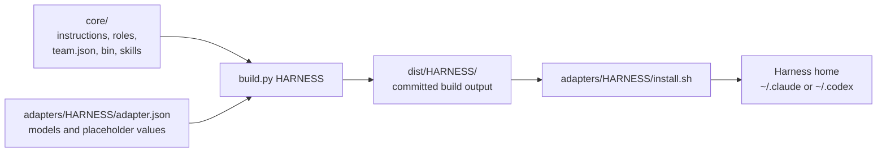

# Harnesses

The workflow is written once in `core/` and rendered for each agent harness, Claude Code and Codex CLI, by `build.py` through an adapter.



## Know what each part supplies

| Part | Supplies |
|---|---|
| `core/instructions.md`, `core/roles/*.md` | The workflow and role prose, with `{{placeholders}}` wherever the harnesses differ. |
| `core/team.json` | Each role's description and model tier: `strong`, `standard`, or `fast`. |
| `core/bin/`, `core/skills/` | `team-guard`, `mutation-check`, and the `jev-decide` skill, shared by every harness. |
| `adapters/<harness>/adapter.json` | The `harness` type, the model for each tier, and a value for every placeholder. |

| Tier | Claude Code | Codex CLI |
|---|---|---|
| `strong` | `claude-opus-5-5` | `gpt-6-astra` |
| `standard` | `claude-sonnet-5-5` | `gpt-6-sol` |
| `fast` | `claude-haiku-4-5-20251001` | `gpt-6-luna` |

The Codex adapter also sets a reasoning effort per tier (`efforts`).

## Build

Build one harness per run, from the repo root:

```bash
./build.py claude-code
./build.py codex
./build.py --check claude-code   # exit 1 if dist/claude-code is stale
```

`build.py`:

- Renders `core/instructions.md` into `CLAUDE.md` or `AGENTS.md`, and appends the adapter's optional `instructions_footer`.
- Renders each role from its prose and its `team.json` entry.
- Renders each skill's `SKILL.md`, and copies the skill's other files and `core/bin/` unchanged.
- Fails if a file uses a placeholder the adapter doesn't define.

Role prose in `core/roles/` has no frontmatter; the build generates it from `team.json`:

| Harness | Role file | Generated from `team.json` and the adapter |
|---|---|---|
| Claude Code | `dist/claude-code/agents/<role>.md` | YAML frontmatter with `name`, `model`, and `description`, followed by the prose |
| Codex CLI | `dist/codex/agents/<role>.toml` | `name`, `description`, `model`, and `model_reasoning_effort`, with the prose in `developer_instructions` |

The build parses each TOML file before writing it, so it fails rather than ship a file Codex can't read.

`dist/` is committed so diffs stay readable.
Don't edit it: change `core/` or an adapter, then rebuild.
`tests/run.sh` checks that every `dist/` is up to date; `tests/run.sh --slow` adds the `mutation-check` test.

## Ship the vendored skills

These are [Matt Pocock's skills](https://github.com/mattpocock/skills), MIT licensed, copied into `core/skills/` and pinned at one commit recorded in `core/skills/UPSTREAM.json`.
The plugin is not installed, and the copies never auto-update, so prompts that run commands can't change under you.
Every copy carries its `LICENSE` and a provenance line naming the source, the commit and whether it was modified.
A patched skill is upstream plus a stored patch in `core/skills/patches/`, which keeps workflow files in the workspace dir and never in a project repo.

| Skill | Status | Used by |
|---|---|---|
| `grilling` | as-is | product-owner, for the upfront round of questions |
| `codebase-design` | as-is | architect, for an options brief |
| `writing-for-agents` | as-is | whoever edits `core/` |
| `domain-modeling` | patched | architect: ADRs as `adr/NNNN-<slug>.md` and an optional `GLOSSARY.md`, both in the workspace dir |
| `handoff` | patched | the human, as a slash command; writes `handoff-<slug>.md` in the workspace dir |
| `to-questionnaire` | patched | the human, as a slash command; writes `to-questionnaire-<slug>.md` in the workspace dir |
| `diagnosing-bugs` | patched | Bug fix: the tester builds the feedback loop and the regression test, the engineer fixes |
| `tdd-inner-loop` | patched (upstream `tdd`) | software-engineer only |

`build.py` ships only the directories of `core/skills/` that hold a `SKILL.md`, so `UPSTREAM.json` and `patches/` stay behind. It renders each `SKILL.md` with the adapter's vars: `skill_call`, `skill_sigil` and `user_skill_sigil` say how a skill names another one (Claude Code calls the Skill tool; Codex mentions `$name`).

Run `scripts/vendor-check` to see drift: it compares each copy with upstream at the pin plus its patch (`local drift`) and with a newer ref (`upstream changed`, `upstream removed`, or a `patch conflict`), reports a LICENSE the upstream deleted as `LICENSE: upstream removed`, exits 1 on drift and 2 when it can't run, and never changes anything.
Moving the pin is a person's decision: update the copies and patches, then the pin.

The byte-for-byte checks need a local clone of upstream at the pin. Run the suite with `VENDOR_UPSTREAM_CLONE=<path to a clone of mattpocock/skills at the pin> tests/run.sh`; without it those tests skip with that reason, and nothing touches the network.

## Know what is unverified

On Codex, the engineer loads `$tdd-inner-loop` by mentioning it in its developer instructions. The Codex docs say an explicit `$skill` mention still works when implicit invocation is off, but that loading from developer instructions rather than a user turn is unverified.
If it doesn't load, the lead can put `$tdd-inner-loop` in the engineer's spawn prompt, which is a user turn.

## Install

Each installer runs `tests/run.sh` first, backs up what it replaces to `backups/agentic-workflow-<timestamp>-<suffix>/` in the harness home (a new directory on every run, even within one second), and copies the build.
That includes every skill directory it is about to write, under `skills/` in the backup.
If a skill's target is a symlink, for example into a `skills.sh` store, the installer backs up the link itself and replaces it with a real directory, so it never writes through the link.
An existing skill directory is backed up, then removed and copied fresh, so nothing is written through a symlink inside it and your own files never merge into ours.
If a skill can't be installed, the installer prints `agentic-workflow install: skill <name> failed: ...` and exits non-zero.
The Jev denylist is never emptied: when `jev-decide` is replaced, including through a symlink, the installer reads your existing `denylist.txt` (following the link) and copies it into the new directory, and it creates the empty default only when no denylist existed. It prints a note either way.
If an upstream `tdd` skill is installed, it warns that its trigger phrases can fire in the tester and suggests removing it; it never deletes it.
Neither installer edits your settings or merges hooks.

### Install for Claude Code

```bash
adapters/claude-code/install.sh
```

It installs `~/.claude/CLAUDE.md`, `~/.claude/agents/*.md`, the tools in `~/.claude/team/bin/`, and the skills in `~/.claude/skills/`.
Then merge `adapters/claude-code/settings.hooks.json` into `~/.claude/settings.json`:

- Add the `PreToolUse` entry, which runs `team-guard hook-pretool` on `Edit`, `Write`, `MultiEdit`, `NotebookEdit`, `Read`, `Grep`, and `Glob`, alongside your existing entries.
- Add the `SubagentStop` hook, which runs `team-guard hook-stop`, and the `TaskCompleted` hook, which runs `team-guard hook-task` (for agent-team teammates).
- Add the allow rules for `team-guard` and `mutation-check`.

> **Caution:** The installer overwrites `~/.claude/CLAUDE.md` and the agent files, after backing them up. Make future edits in `core/`, rebuild, and reinstall, or the copies drift.

### Install for Codex CLI

```bash
adapters/codex/install.sh
```

It installs `~/.codex/AGENTS.md`, `~/.codex/agents/<role>.toml`, the tools in `~/.codex/team/bin/`, and the skills in `~/.agents/skills/`.
It also writes `~/.codex/rules/agentic-workflow.rules`, which lets `team-guard`, `mutation-check`, and `ask-jev` run outside the sandbox.
Then:

1. Merge `adapters/codex/hooks.json` into `~/.codex/hooks.json`, keeping your existing hooks. It adds a `PreToolUse` hook on `apply_patch`, `Edit`, and `Write`, and a `SubagentStop` hook that runs `team-guard hook-stop`.
2. Turn hooks on with `[features] hooks = true` in `config.toml`.
3. Run `/hooks` in Codex and trust the two `team-guard` hooks. Codex doesn't run untrusted hooks.

## Compare the harnesses

| | Claude Code | Codex CLI |
|---|---|---|
| Instructions | `~/.claude/CLAUDE.md` | `~/.codex/AGENTS.md`, with no `@imports` and a 32 KiB cap together with project `AGENTS.md` files |
| Step ordering | The lead starts one subagent per step and waits for its report | The lead spawns each step with `spawn_agent` and waits with `wait_agent` |
| Agent-to-agent messages | `SendMessage` | None between subagents: the engineer reports a disputed test to the lead |
| Edit guard | `PreToolUse` on `Edit` and `Write` (`file_path`) | `PreToolUse` on `apply_patch`, with paths parsed from the patch |
| Completion guard | `SubagentStop` (a JSON `block` decision, once per stop) and `TaskCompleted` (exit 2, agent teams) | `SubagentStop`, a JSON `block` decision, once per stop |
| Agent identification | `agent_type` inside subagents, none documented for agent-team teammates | `agent_type` for subagents, omitted on the main thread |
| Tool permissions | Allow rules in `settings.json` | `prefix_rule`s in `~/.codex/rules/` |
| Skills | `~/.claude/skills/` | `~/.agents/skills/` (`$jev-decide`) |

Where the harness doesn't identify the agent, the git hooks and `team-guard verify` still catch changes to sealed tests.
Codex has no `Read` tool to hook, so holdout isolation there relies on instructions and paths.

Both harnesses share the workspace, holdout, and archive directories under `~/.agentic-workflow/`, so one team can mix them.

## Add a harness

1. Create `adapters/<harness>/adapter.json` with `harness`, `models`, and a value for every placeholder in `core/`.
2. Add a builder for its output format to `BUILDERS` in `build.py`, unless its `harness` type reuses an existing one.
3. Run `./build.py <harness>`, and add an `install.sh` next to the adapter.

## Next steps

- Follow the steps in [Workflow](./workflow.md).
- See what the hooks enforce in [Guard rails](./guard-rails.md).
