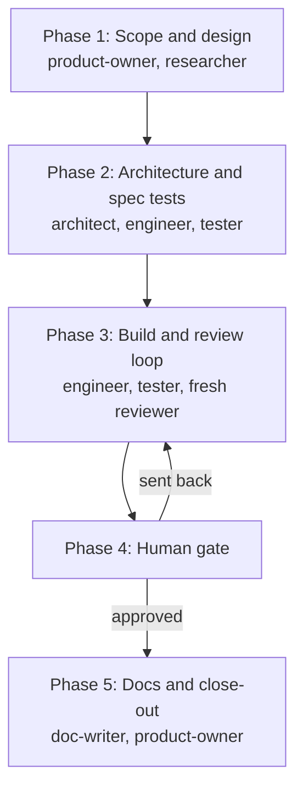
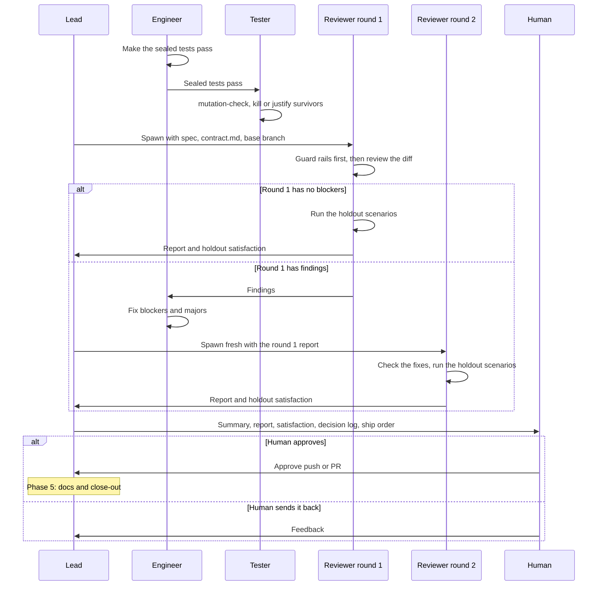

# Workflow

A feature moves through five phases, from spec to close-out, with a human gate before anything is pushed.

Run the whole team from one [workspace](./workspaces.md).
Use as many roles as the change needs: a small bug fix might only need an engineer and a tester.

## Phase 1: Scope and design

The product-owner and the researcher work in parallel.

- The product-owner writes the spec, with numbered EARS acceptance criteria (`WHEN …, the system SHALL …`).
- The researcher writes the design docs.

The acceptance criteria are the tests' only source of truth, so each one must be testable.

## Phase 2: Architecture and spec tests

1. The architect writes the design docs, then `contract.md`: the public interfaces, plus a sprint contract that says how each criterion is verified.
2. The engineer scaffolds the contract as stubs that compile and fail loudly (`not implemented`).
3. The tester, working in isolation, writes acceptance, integration, e2e, and property-based tests from the spec and `contract.md` only.
4. The tester proves each test fails against the stubs for the right reason, then commits and seals the tests.
5. The tester writes 3–8 holdout scenarios that the engineer never sees.

Steps 2 and 3 both depend on `contract.md`.
See [Guard rails](./guard-rails.md) for what sealing does.

## Phase 3: Build and review loop

This phase starts once the tests are sealed.

1. The engineer makes the sealed tests pass without changing them.
2. The tester runs `mutation-check` and kills or justifies every surviving mutant on changed code.
3. A fresh reviewer reviews the diff against the spec.
   The engineer fixes blockers and majors, and a new reviewer checks the fixes.
   There are at most two rounds.
4. The final round's reviewer also runs the holdout scenarios and reports satisfaction: scenarios passed out of total.

Blockers that remain after round 2 go to the human.
There's no third round.

### What the reviewer checks

The reviewer runs the mechanical checks before any judgment:

- `team-guard verify` from the workspace dir. Any modified sealed test is a blocker.
- `team-guard list` in each attached worktree. Every unseal in the lock history must match a tester note, or it's a blocker.
- The sealed tests and the project's relevant suite, run by the reviewer.
- The tester's mutation notes. An unjustified survivor on a spec'd behavior is a major.
- The decision log. The reviewer confirms or rejects every `PROVISIONAL` decision.

In round 2, the reviewer only checks that round-1 blockers and majors are fixed without breaking anything.

### When a sealed test looks wrong

The engineer doesn't change it.
Instead, the engineer reports the failing assertion, the spec clause, and their reading of it to the tester.
In Claude Code the engineer messages the tester; in Codex, the engineer reports to the lead, who relays it.

Only the tester changes a sealed test, and only when it contradicts the spec.
The tester unseals it, fixes it, commits, reseals, and notes the reason.

## Phase 4: Human gate

Before any push, the lead hands you:

- A summary of the change.
- The final review report.
- The holdout satisfaction.
- The decision log (`jev-decisions.md`).
- For a feature that spans repos, the ship order and its reason, which the architect records in the workspace dir.

You approve, or send it back.
Nothing is pushed without your approval.

## Phase 5: Docs and close-out

The doc-writer and the product-owner work in parallel.
The doc-writer updates the user-facing docs; the product-owner updates the roadmap and issues.

After you merge, the product-owner runs `team-guard workspace close <feature>` from outside the workspace.
It archives the artifacts, removes the attached worktrees and holdouts, and keeps every branch.
See [Close a workspace](./workspaces.md#close-a-workspace).

## Keep context separate

Separate agents only help if their contexts stay separate.

- **Tester:** the spawn prompt holds only the paths to the spec and `contract.md`, and the task. No design notes, plans, or engineer output.
- **Reviewer:** the spawn prompt holds the spec, `contract.md`, and the base branch. Each round gets a new reviewer, with the previous round's report but not the engineer's explanations.
- **Holdout scenarios:** they live outside every repo and the workspace dir. Nobody mentions their content to the engineer.

## Drive the loop with `/goal`

You can run the lead session under a `/goal` so it keeps moving through the phases on its own.
The goal ends at the human gate, never at a push.
Copy the condition from the global instructions (`CLAUDE.md` or `AGENTS.md`) and fill in the feature name.

The condition stops and hands to you when blockers remain after round 2, a Jev verdict is `DEFER`, or a security question comes up.
It also stops when a phase is blocked on your decision, or after its turn cap.

## Write commits and PRs in project terms

Commit messages and PR descriptions read as ordinary project changes.
Don't use workflow jargon such as "sealed", "holdout", "Jev", or "mutation survivors" in them.

- **Good:** "Add rate-limit middleware to the API handler"
- **Bad:** "Sealed tests for rate limiting; mutation survivors killed"

## Next steps

- Set up a feature in [Workspaces](./workspaces.md).
- Learn how sealing and verification work in [Guard rails](./guard-rails.md).
- Unblock small choices with [Decisions with Jev](./decisions-with-jev.md).
