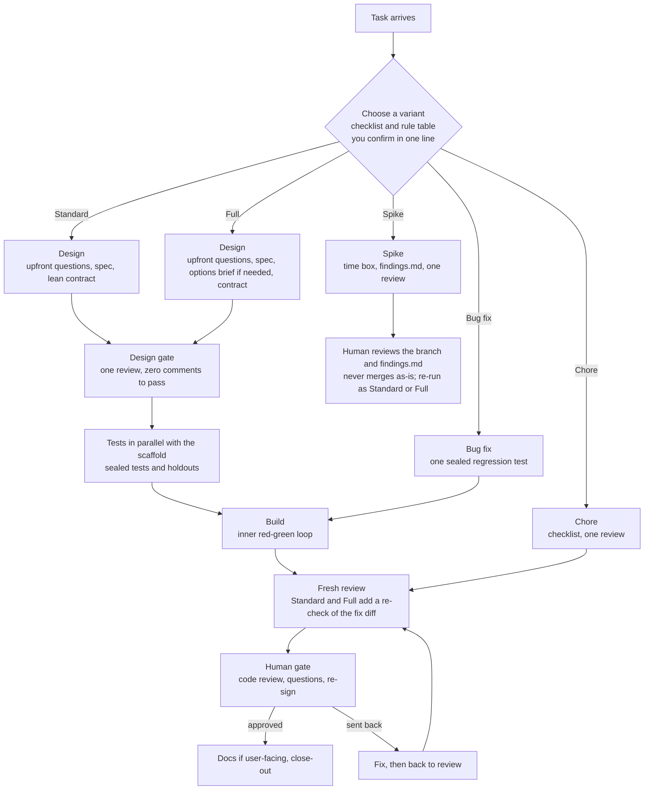
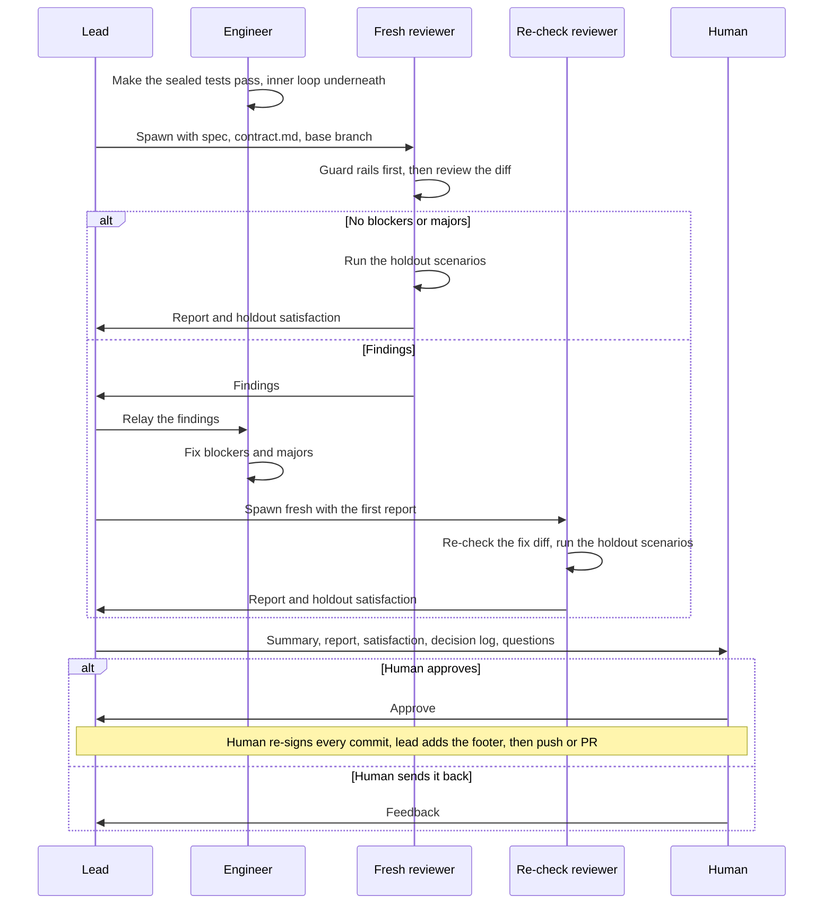

# Workflow

Every task runs as one of five variants, sized to the work, with a design gate before tests are sealed and a human gate before anything is pushed.



Run the whole team from one [workspace](./workspaces.md).
The lead starts one subagent per step and waits for its report.

## Choose a variant

The lead answers ten questions about the task without reading any code, then applies a rule table top-down.
The first match wins, and an unknown answer counts as "yes", so uncertainty routes to more process.

1. How many repos does it touch?
2. Roughly how many files and lines change: 3 files or fewer, 4–15, or more than 15?
3. Does it change a public contract?
4. Does it touch persisted data or migrations?
5. Does it touch security?
6. Is it cross-team?
7. Can a plain `git revert` undo it?
8. Does it change behavior a user can see?
9. Is there an open design question?
10. Is there a repro for a defect?

| # | Condition | Variant |
|---|---|---|
| 1 | The request is exploratory ("can this work?", "what's the shape of it?") | Spike |
| 2 | Security-relevant (the lead flags it to you now) | Full |
| 3 | More than one repo, a public contract, persisted data, cross-team, or not revertible | Full |
| 4 | An open design question, or more than 15 files | Standard |
| 5 | A defect with a repro, 15 files or fewer, no flags | Bug fix |
| 6 | No behavior change a user can see, 3 files or fewer, no flags | Chore |
| 7 | Anything else | Standard |

The lead proposes the variant, and you confirm or override it in one line before work starts.
Jev does not route.
A variant can be upgraded mid-run and is never downgraded, and an open design question moves a task up to at least Standard.

What each variant gets:

| | Chore | Bug fix | Spike | Standard | Full |
|---|---|---|---|---|---|
| Spec / criteria | checklist of up to 3 items | lead writes it, 1–5 | none; a time box | 5–20 | 20–40 per slice |
| Design gate | none | none | none | one gate | one gate (D1 + D2 if split) |
| Sealed tests | none | regression test only | none | yes | yes |
| Holdouts | 0 | 0 | 0 | 1–2 | 2–4 |
| Mutation testing | off | off | off | off | off; opt-in for risk-flagged modules |
| Review | 1 | 1 (2 if blockers) | 1 | 1 + fix re-check | 1 + fix re-check |
| Human code review | always | always | always | always | always |

A **Spike** is time-boxed exploration by one engineer, with no spec, contract, seal or holdouts.
It produces a branch and a `findings.md`, gets one review and then your review, and never merges as-is.
To ship it, re-run as Standard or Full with the findings as input.

The lead records the routing decision with `team-guard routing record route` at kickoff, and the wall time of each step with `team-guard routing record step` after each step.
Each record goes to `routing.md` in the workspace dir (a Chore has no workspace, so its record goes in the git directory) and to the shared log `~/.agentic-workflow/routing-log.jsonl`.
`team-guard routing summary` shows override and upgrade rates and time per variant.

## Steps by variant

Full and Standard both have five steps, followed by the human gate.

**Full**

1. **Design.** The product-owner opens with one round of questions to you, then writes the spec (at most 40 criteria per slice). The architect writes an options brief only if there are real design options, then `contract.md`.
2. **Design gate.** One review of the spec, the contract and any brief.
3. **Tests in parallel with the scaffold.** The tester seals one test per criterion for each slice and writes 2–4 holdout scenarios, while the engineer scaffolds the contract as failing stubs.
4. **Build.** The engineer makes the sealed tests pass with an inner red-green loop.
5. **Review.** One fresh reviewer, then a targeted re-check of the fix diff only. The holdouts run in the pass that ends the review: the first pass if it has no blockers or majors, otherwise the re-check.

**Standard** has the same five steps, lighter: a lean contract, no options brief unless there is an open design question, 1–2 holdouts and no mutation testing.

A Bug fix is one cycle: the lead writes 1–5 criteria, the tester seals one regression test that covers them and fails on the defect, the engineer fixes it, and one fresh review follows.
A Chore is a checklist of up to three items and one review.

The researcher is no longer a pipeline step.
The architect absorbs the researcher's brief, and the researcher stays available for research requests outside the pipeline.
The doc-writer runs only when user-facing docs change.
The product-owner runs the upfront questions with the `grilling` skill.

See [Guard rails](./guard-rails.md) for what sealing does.

## Design gate

The default is one design gate over the spec, `contract.md` and any brief.
You discuss them, and each decision is recorded as an ADR in the workspace `adr/` directory.
D1 (spec and brief) and D2 (contract and ADRs) run as separate reviews only when the brief has an open option and the contract depends on the choice.

Nothing is sealed until the gate passes (Bug fix and Chore have no gate).
The gate passes when you finish the review with zero comments.
The lead then records the approval in `design-gate.md` with the sha256 of each reviewed file.
If `contract.md` changes afterwards, `team-guard gate check` exits 2 and the gate reopens.

The lead runs the review with `team-guard gate review`, a local Crit session.
Its output stays under `<workspace>/.crit`, each comment goes to the owner of the file, who answers with `team-guard gate reply`, and the lead never shares or pushes a review.
Approval deletes Crit's review data, so `gate review` exports each round's comments to `reviews/` as it runs.
If the wait is stopped, the lead re-runs it and the same session continues.
When you approve, the lead runs `team-guard gate record <gate> --crit` to save the approved hashes.
The tester never reads `.crit/` or `reviews/`, and its hook denies them: it sees only the approved spec and contract.

Where Crit is unavailable, or in Codex, the lead posts numbered questions in chat.
Reply `approve design` to pass the single gate, or `approve D1` or `approve D2` when the gates are split.
No other reply counts as approval, and the lead records it with `team-guard gate record`.

## Double-loop tests

The tester seals one test per criterion at a contract seam, plus a second only for a documented error or a stated invariant.
End-to-end tests aren't a default; the holdouts cover whole flows.
When end-to-end tests are written, the tester runs them once against the live base app before sealing, so a failure means "feature missing" and not a wrong selector, route or setup.

Underneath, the engineer drives each sealed test green with an inner loop of unit tests it owns.
Those tests aren't sealed and don't count as evidence for a criterion.
The reviewer checks them for tautologies and for mocks of the project's own modules.

In Full the tester seals per slice, just in time.

Code, comments, test names and file names never cite spec criterion IDs, contract sections, addenda or review rounds.
They describe behavior and the reason for it.
`team-guard refs` checks changed lines and file names for it, and the reviewer treats a violation as a finding.



Blockers that remain after the re-check go to you.
There's no further round.

### What the reviewer checks

The reviewer runs the mechanical checks before any judgment:

- `team-guard verify` from the workspace dir. Any modified sealed test is a blocker.
- `team-guard list` in each attached worktree. Every unseal in the lock history must match a tester note, or it's a blocker.
- The sealed tests and the project's relevant suite, run by the reviewer.
- Mutation notes, if mutation testing was run.
- The decision log. The reviewer confirms or rejects every `PROVISIONAL` decision.

The re-check only confirms that the blockers and majors are fixed without breaking anything.

### When a sealed test looks wrong

The engineer doesn't change it.
Instead, the engineer reports the failing assertion, the spec clause, and their reading of it to the tester.
In Claude Code the engineer messages the tester; in Codex, the engineer reports to the lead, who relays it.

Only the tester changes a sealed test, and only when it contradicts the spec.
The tester unseals it, fixes it, commits, reseals, and notes the reason.

## Mutation testing

Mutation testing is off by default in every variant.
In Full it is opt-in for risk-flagged modules, and then it is sampled and time-boxed.
Python has no supported mutation path.
`mutation-check` bounds every run: it refuses to start below `--min-free-gb` (default 20; exit 3), runs `--max-concurrency` workers (default 2), samples `--sample` changed lines (default 50) and stops at `--time-box` minutes (default 15; exit 4).
It removes its temp files on every exit.

## Speed rules

- **Questions are batched.** Non-blocking questions and Jev `DEFER` verdicts go into `questions.md` while the agent continues with a `PROVISIONAL` choice. You answer them together at the next gate. Only blocking or security questions interrupt you at once.
- **Subagents by default.** The lead starts one subagent per step. Agent-team teammates are used only for parallel work within one step.
- **Scope stays fixed.** A finding that is neither a blocker nor security goes to `followups.md`, not into the current run.
- **Warm environment.** The dev or e2e environment stays running between rounds and restarts only when its config changes.
- **Unsigned commits, re-signed once.** Agents commit unsigned with `git -c commit.gpgsign=false commit …`, a per-command setting that writes no config. After you approve the code review and before anything is pushed, the lead runs `team-guard sign` to re-sign every commit on the branch in every attached repo, with the human's key through their configured signer. Whether that prompts you depends on the signer's approval settings; see [Re-sign the branch](./guard-rails.md#re-sign-the-branch).

## Human gate

Before any push, the lead hands you:

- A summary of the change.
- The final review report.
- The holdout satisfaction.
- The decision log (`jev-decisions.md`) and the questions waiting in `questions.md`.
- For a feature that spans repos, the ship order and its reason, which the architect records in the workspace dir.

You approve, or send it back.
Nothing is pushed without your approval.

## Merge-risk footer

Every PR carries an advisory merge-risk footer of High, Medium or Low, with a reason in project terms, added after you approve the human-gate summary:

```text
Merge risk: high (advisory) — changes the stored config format; a revert needs the old format restored.
```

The level comes from a table checked top-down over facts about the change: persisted data, a breaking public-contract change, several repos, security or a hard revert give High.
An additive public-contract change, user-visible behavior, more than 15 files or a change over the review budget, deploy, CI or config files, a major fixed in review, an unseal, skipped mutation testing on a risk-flagged module, or any failed holdout scenario (variants with no holdouts never trigger this) give Medium; anything else (docs, tests, or an internal change) gives Low.
Any unknown input counts as "yes", and review findings, unseals and skipped mutation testing can only raise the level.
The footer never names size: size alone adds no reason text.
`team-guard risk` computes the level, and `--packet` prints the rules and inputs for your review packet.

## Close out

The doc-writer runs only when user-facing docs changed, and the product-owner updates the roadmap and issues, turning `followups.md` into issues.

After you merge, the product-owner runs `team-guard workspace close <feature>` from outside the workspace.
It archives the artifacts, removes the attached worktrees and holdouts, and keeps every branch.
See [Close a workspace](./workspaces.md#close-a-workspace).

## Keep context separate

Separate agents only help if their contexts stay separate.

- **Tester:** the spawn prompt holds only the paths to the spec and `contract.md` in their approved state, and the task. No design notes, plans, review comments, or engineer output.
- **Reviewer:** the spawn prompt holds the spec, `contract.md`, and the base branch. The re-check gets a new reviewer, with the first report but not the engineer's explanations.
- **Holdout scenarios:** they live outside every repo and the workspace dir. Nobody mentions their content to the engineer.

## How the lead runs the steps

The lead drives each step itself and starts the next only on the previous subagent's report.
It stops at every design gate and at the human gate, and never pushes without your approval.
It hands to you when blockers remain after the re-check, a Jev verdict is `DEFER` and blocks the work, a security question comes up, or a step needs your decision.
It checks in after a cap of turns per variant (Bug fix 20, Standard 40, Full 60), and shows test and `team-guard verify` output at each step.

## Keep each PR reviewable

In Full, each slice gets its own PR, opened once the slice passes review and stacked on the previous slice's branch when it depends on it.
You review each slice's PR; the lead re-signs and pushes per slice only after your approval, and retargets the next PR with `gh pr edit` when a base merges.
Standard, Bug fix and Chore produce one PR; a Spike produces none.
Each PR stays within about 400 changed lines to review, excluding tests and generated code.
Change the budget with `--pr-budget N` or `TEAM_PR_BUDGET`.
A slice that cannot be split into coherent vertical pieces states why in the contract, and approving the contract approves that exception.
Otherwise, over budget at the human gate, the lead asks you to reply `approve over budget`.
The reviewer who ends the review writes `review-guide.md` in the workspace dir (`Where to look first`, `Checked mechanically`, `Not verified`, `Provisional decisions`), and the PR description carries its `Where to look` section.

## Write commits and PRs in project terms

Commit messages and PR descriptions read as ordinary project changes.
Don't use workflow jargon such as "sealed", "holdout", "Jev", or "mutation survivors" in them.

- **Good:** "Add rate-limit middleware to the API handler"
- **Bad:** "Sealed tests for rate limiting; mutation survivors killed"

## Next steps

- Set up a feature in [Workspaces](./workspaces.md).
- Learn how sealing and verification work in [Guard rails](./guard-rails.md).
- Unblock small choices with [Decisions with Jev](./decisions-with-jev.md).
