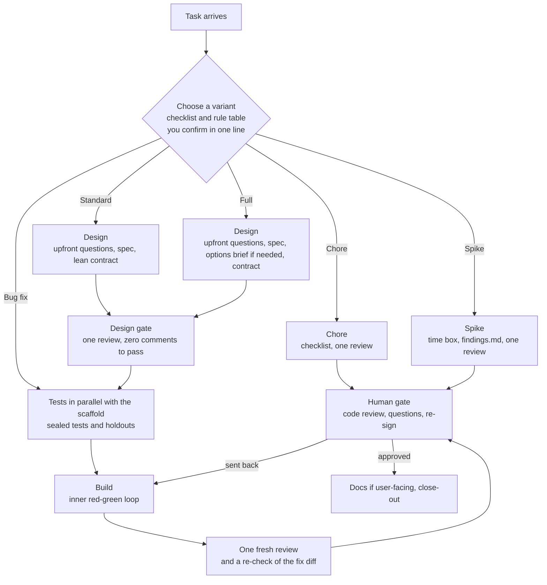
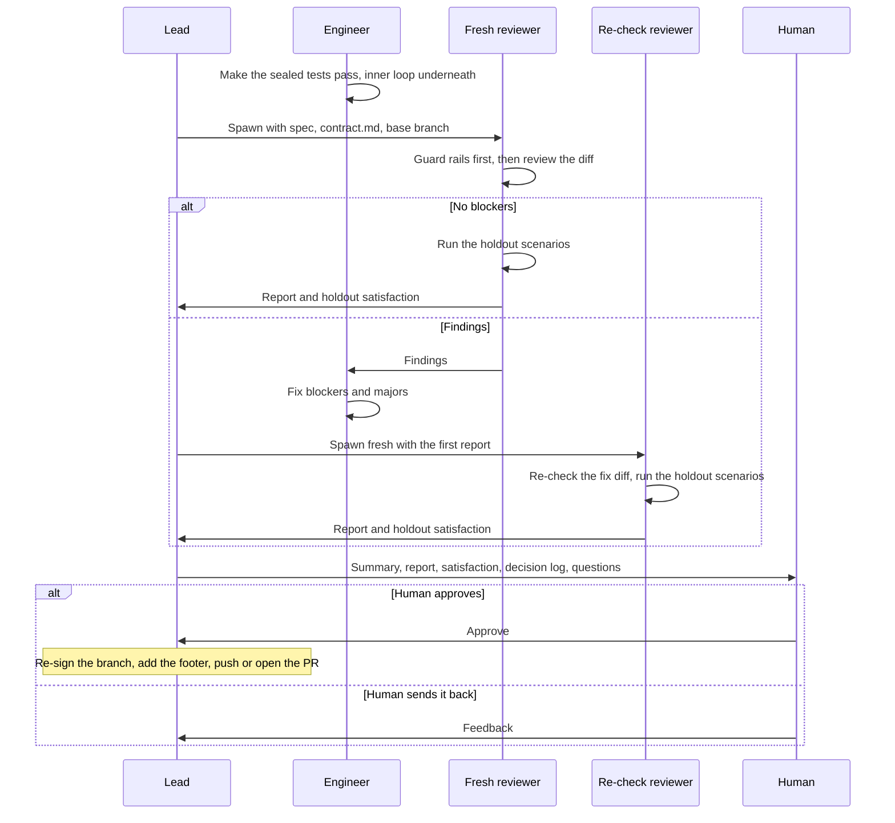

# Workflow

Every task runs as one of five variants, sized to the work, with a design gate before tests are sealed and a human gate before anything is pushed.



Run the whole team from one [workspace](./workspaces.md).
The lead starts one subagent per step and waits for its report.

## Choose a variant

The lead answers ten questions about the task without reading any code, then applies a rule table top-down.
The first match wins, and an unknown answer counts as "yes", so uncertainty routes to more process.

1. How many repos does it touch?
2. Roughly how many files will change?
3. Does it change a public contract?
4. Does it touch persisted data or migrations?
5. Does it touch security?
6. Is it cross-team?
7. Is it easy to revert?
8. Is it user-facing?
9. Is there an open design question?
10. Is there a repro for a defect?

| # | Condition | Variant |
|---|---|---|
| 1 | The request is exploratory ("can this work?", "what's the shape of it?") | Spike |
| 2 | Any risk flag: public contract, persisted data, security, cross-team, hard to revert | Full |
| 3 | It touches several repos | Full |
| 4 | There is an open design question | Standard |
| 5 | A defect with a repro and no risk flags | Bug fix |
| 6 | Not user-facing, no behavior change | Chore |
| 7 | Anything else | Standard |

The lead proposes the variant, and you confirm or override it in one line before work starts.
Jev does not route.
A variant can be upgraded mid-run and is never downgraded, and an open design question moves a task up to at least Standard.

What each variant gets:

| | Chore | Bug fix | Spike | Standard | Full |
|---|---|---|---|---|---|
| Spec / criteria | checklist of up to 3 items | lead writes it, 1–5 | none; a time box | 5–20 | 20–40 per slice |
| Design gate | none | none | none | one gate | one gate (D1 + D2 if split) |
| Sealed tests | none | regression test only | none | yes | yes |
| Holdouts | 0 | 0 | 0 | 1–2 | 2–4 |
| Mutation testing | off | off | off | off | off; opt-in for risk-flagged modules |
| Review | 1 | 1 (2 if blockers) | 1 | 1 + fix re-check | 1 + fix re-check |
| Human code review | always | always | always | always | always |

A **Spike** is time-boxed exploration by one engineer, with no spec, contract, seal or holdouts.
It produces a branch and a `findings.md`, gets one review and then your review, and never merges as-is.
To ship it, re-run as Standard or Full with the findings as input.

The lead records the routing decision and the wall time of each step in `routing.md` in the workspace dir.
A shared log at `~/.agentic-workflow/routing-log.jsonl` is planned; no tool writes it yet.

## Steps by variant

Full and Standard both have five steps, followed by the human gate.

**Full**

1. **Design.** The product-owner opens with one round of questions to you, then writes the spec (at most 40 criteria per slice). The architect writes an options brief only if there are real design options, then `contract.md`.
2. **Design gate.** One review of the spec, the contract and any brief.
3. **Tests in parallel with the scaffold.** The tester seals one test per criterion for each slice and writes 2–4 holdout scenarios, while the engineer scaffolds the contract as failing stubs.
4. **Build.** The engineer makes the sealed tests pass with an inner red-green loop.
5. **Review.** One fresh reviewer, then a targeted re-check of the fix diff only. The reviewer runs the holdouts.

**Standard** has the same five steps, lighter: a lean contract, no options brief unless there is an open design question, 1–2 holdouts and no mutation testing.

A Bug fix is one cycle: the lead writes 1–5 criteria, the tester seals one failing regression test, the engineer fixes it, and one fresh review follows.
A Chore is a checklist of up to three items and one review.

The researcher is no longer a pipeline step.
The architect absorbs the researcher's brief, and the researcher stays available for research requests outside the pipeline.
The doc-writer runs only when user-facing docs change.
An interview skill for the product-owner's upfront questions is planned.

See [Guard rails](./guard-rails.md) for what sealing does.

## Design gate

The default is one design gate over the spec, `contract.md` and any brief.
You discuss them, and each decision is recorded as an ADR in the workspace `adr/` directory.
D1 (spec and brief) and D2 (contract and ADRs) run as separate reviews only when the brief has an open option and the contract depends on the choice.

Nothing is sealed until the gate passes.
The gate passes when you finish the review with zero comments.
The lead then writes `design-gate.md` with the sha256 of each reviewed file.
If `contract.md` changes afterwards, the gate reopens.

The review is a local Crit session.
Its output stays under `<workspace>/.crit`, each comment goes to the owner of the file, and the lead never shares or pushes a review.
Approval deletes Crit's review data, so the lead exports each round's comments to `reviews/` before re-running.
The tester never reads `.crit/` or `reviews/`: it sees only the approved spec and contract.

Where Crit is unavailable, or in Codex, the lead posts numbered questions in chat.
Reply `approve design` to pass the single gate, or `approve D1` or `approve D2` when the gates are split.
No other reply counts as approval.

## Double-loop tests

The tester seals one test per criterion at a contract seam, plus a second only for a documented error or a stated invariant.
End-to-end tests aren't a default; the holdouts cover whole flows.
When end-to-end tests are written, the tester runs them once against the live base app before sealing, so a failure means "feature missing" and not a wrong selector, route or setup.

Underneath, the engineer drives each sealed test green with an inner loop of unit tests it owns.
Those tests aren't sealed and don't count as evidence for a criterion.
The reviewer checks them for tautologies and for mocks of the project's own modules.

In Full the tester seals per slice, just in time.

Code, comments, test names and file names never cite spec criterion IDs, contract sections, addenda or review rounds.
They describe behavior and the reason for it.
An automated check for this is planned; until then the reviewer treats a violation as a finding.



Blockers that remain after the re-check go to you.
There's no further round.

### What the reviewer checks

The reviewer runs the mechanical checks before any judgment:

- `team-guard verify` from the workspace dir. Any modified sealed test is a blocker.
- `team-guard list` in each attached worktree. Every unseal in the lock history must match a tester note, or it's a blocker.
- The sealed tests and the project's relevant suite, run by the reviewer.
- Mutation notes, if mutation testing was run.
- The decision log. The reviewer confirms or rejects every `PROVISIONAL` decision.

The re-check only confirms that the blockers and majors are fixed without breaking anything.

### When a sealed test looks wrong

The engineer doesn't change it.
Instead, the engineer reports the failing assertion, the spec clause, and their reading of it to the tester.
In Claude Code the engineer messages the tester; in Codex, the engineer reports to the lead, who relays it.

Only the tester changes a sealed test, and only when it contradicts the spec.
The tester unseals it, fixes it, commits, reseals, and notes the reason.

## Mutation testing

Mutation testing is off by default in every variant.
In Full it is opt-in for risk-flagged modules, and then it is sampled and time-boxed.
Python has no supported mutation path.
Hard limits in `mutation-check` (a free-disk check, capped concurrency, guaranteed cleanup, an enforced time box) are planned, so until they land the tester keeps the sample and the time box by hand.

## Speed rules

- **Questions are batched.** Non-blocking questions and Jev `DEFER` verdicts go into `questions.md` while the agent continues with a `PROVISIONAL` choice. You answer them together at the next gate. Only blocking or security questions interrupt you at once.
- **Subagents by default.** The lead starts one subagent per step. Agent-team teammates are used only for parallel work within one step.
- **Scope stays fixed.** A finding that is neither a blocker nor security goes to `followups.md`, not into the current run.
- **Warm environment.** The dev or e2e environment stays running between rounds and restarts only when its config changes.
- **Unsigned commits, re-signed once.** Agents commit unsigned, set in their session environment only. Before anything is pushed, every commit on the branch is re-signed at the human gate. A re-sign command is planned; until then you re-sign by hand.

## Human gate

Before any push, the lead hands you:

- A summary of the change.
- The final review report.
- The holdout satisfaction.
- The decision log (`jev-decisions.md`) and the questions waiting in `questions.md`.
- For a feature that spans repos, the ship order and its reason, which the architect records in the workspace dir.

You approve, or send it back.
Nothing is pushed without your approval.

## Merge-risk footer

Every PR carries an advisory merge-risk footer of High, Medium or Low, with a reason in project terms, added after you approve the human-gate summary:

```text
Merge risk: high (advisory) — changes the stored config format; a revert needs the old format restored.
```

The level comes from a table checked top-down over facts about the change: persisted data, a public contract, several repos, security or a hard revert give High.
Any unknown input counts as "yes", and review findings, unseals and skipped mutation testing can only raise the level.
A script that computes the level is planned; until it exists the lead applies the table by hand.

## Close out

The doc-writer runs only when user-facing docs changed, and the product-owner updates the roadmap and issues, turning `followups.md` into issues.

After you merge, the product-owner runs `team-guard workspace close <feature>` from outside the workspace.
It archives the artifacts, removes the attached worktrees and holdouts, and keeps every branch.
See [Close a workspace](./workspaces.md#close-a-workspace).

## Keep context separate

Separate agents only help if their contexts stay separate.

- **Tester:** the spawn prompt holds only the paths to the spec and `contract.md` in their approved state, and the task. No design notes, plans, review comments, or engineer output.
- **Reviewer:** the spawn prompt holds the spec, `contract.md`, and the base branch. The re-check gets a new reviewer, with the first report but not the engineer's explanations.
- **Holdout scenarios:** they live outside every repo and the workspace dir. Nobody mentions their content to the engineer.

## Drive the loop with `/goal`

You can run the lead session under a `/goal` so it keeps moving on its own.
There is one goal per gate: the design gate (with separate D1 and D2 goals when the gates are split) and the human gate, with a human-gate goal for each of Bug fix, Standard and Full.
Each goal ends at its gate, never at a push.
Copy the one you need from the global instructions (`CLAUDE.md` or `AGENTS.md`) and fill in the feature name.

The human-gate goal stops and hands to you when blockers remain after the re-check, a Jev verdict is `DEFER` and blocks the work, or a security question comes up.
It also stops when a step is blocked on your decision, or after its turn cap.

## Write commits and PRs in project terms

Commit messages and PR descriptions read as ordinary project changes.
Don't use workflow jargon such as "sealed", "holdout", "Jev", or "mutation survivors" in them.

- **Good:** "Add rate-limit middleware to the API handler"
- **Bad:** "Sealed tests for rate limiting; mutation survivors killed"

## Next steps

- Set up a feature in [Workspaces](./workspaces.md).
- Learn how sealing and verification work in [Guard rails](./guard-rails.md).
- Unblock small choices with [Decisions with Jev](./decisions-with-jev.md).
