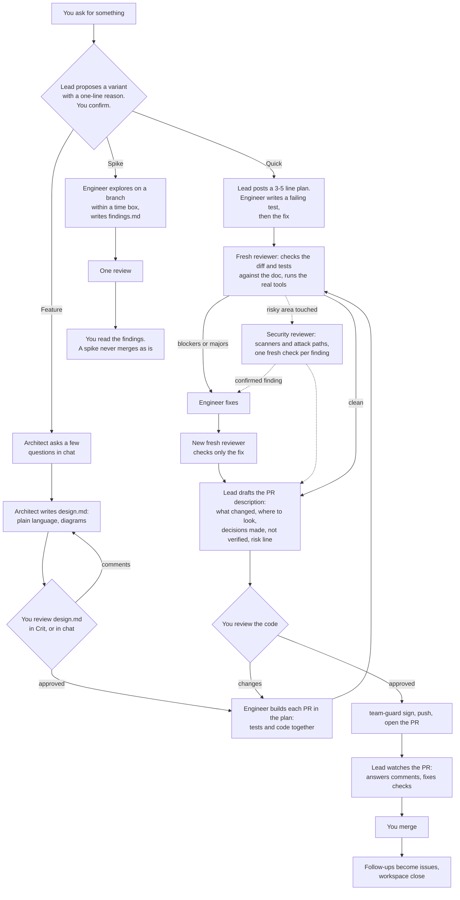

# Workflow

You ask for something. The lead picks a variant, the team builds it, a fresh reviewer checks it, and you review every PR before anything is pushed.

The lead stops and asks you at four points: the variant, the design doc (Feature only), the code review before anything is pushed, and any problem it cannot settle alone (a blocker left after the re-check, a security question, or a design change during the build).

## Pick a variant

| Variant | For | Design doc | What happens |
|---|---|---|---|
| **Quick** | A chore, or a bug with a repro, with no open design question | No. A 3 to 5 line plan in chat. | The engineer writes a failing test (for a bug, following `diagnosing-bugs`), fixes it, gets one review, and you review the code. |
| **Feature** | Any new or changed behavior, or any open design question | Yes | The full flow above. |
| **Spike** | "Can this work?" or "what shape would it have?" | No. A time box. | A branch plus `findings.md`, one review. To ship it, run it again as a Feature with the findings as input. |

The lead picks by judgment and says why in one line. Security, stored data, a public interface others rely on, and work in more than one repo always mean Feature. A task can move up, never down.

## What you see and approve

| When | What you get | What you do |
|---|---|---|
| Start | The variant and a one-line reason (plus the short plan for Quick) | Confirm or change it in one line |
| Feature, before the doc | A few numbered questions, each with a recommendation | Answer, or accept the recommendations |
| Feature, design | `design.md` in Crit (diagrams render there), or in chat | Comment until you are happy, then approve in Crit, or reply `approve design` in chat |
| During the build | Nothing, unless there is a blocker, a security question or a design change | Answer in one line |
| Before any push | The draft PR description and the full diff, test changes included | Approve, or ask for changes |
| Open PR | Replies to your comments, and fixes | Resolve threads, merge |

When you approve the doc, the lead adds "Approved on <date>" at its top and saves a copy as `design-approved.md`. If the design must change during the build, the lead adds a "Changes after approval" note at the end of the doc and asks you in one line.

## Read a design doc

Every Feature gets one `design.md` in its workspace, never in the project repo. It is plain language, has at least one Mermaid diagram, and aims for under five pages.

| Section | What goes in it |
|---|---|
| Title and summary | What we are building and the approach, in one line |
| 1. The problem | What is wrong or missing, who feels it, and what "done" looks like |
| 2. How it will work | A component diagram, a sequence diagram of the main and failure paths, and examples of what a user will see |
| 3. What changes | The files, commands or data added, changed or removed (when it helps) |
| 4. Decisions and alternatives | For each real choice: what we chose, what we didn't, and why |
| 5. How we'll know it works | The behaviors the tests cover, the scenarios the reviewer runs against the real tool, and what can't be verified |
| 6. Risks | Data, security, compatibility and how hard it is to undo |
| 7. Rollout and PR plan | The PRs in order, their rough size (about 400 changed lines, tests not counted), how each is reverted |
| 8. Open questions | Anything undecided, each with a recommendation |

## Who does what

| Role | Does | Produces |
|---|---|---|
| Lead (the main session) | Proposes the variant, starts each agent, checks test output itself, drafts the PR description, signs, pushes, watches the PR | The PR |
| Architect | Asks a few questions, writes and revises the design doc | `design.md` |
| Engineer | Writes tests and code together (red, then green), keeps `tests.md`, notes decisions made during the build | Code, tests |
| Reviewer (fresh each time) | Checks code and tests against the doc, confirms the tests cover its test section, runs the real-tool scenarios, writes "Where to look" and the risk line | Findings, `review-guide.md` |
| Security reviewer | Starts only when the design's risks or the diff touch a risky area, or the reviewer asks. Runs the installed scanners on the diff and traces untrusted input to risky operations. A second fresh run per finding tries to disprove it | `security-review.md` |
| Doc-writer | Updates user-facing docs, only when they change | Docs |
| Researcher, product-owner | On request, outside the flow | Notes, issues |

A confirmed security finding is a blocker (a low one a major), and the engineer fixes it before the PR. The PR description gets one neutral line, and the report stays in the workspace. A security fix, or a vulnerability the review finds in existing code, stops the work before any push so you decide what happens with the details; security findings never become public issues or PRs without your say-so.

The agents keep a few files for themselves, in the workspace: `tests.md` (one line per behavior in the doc's test section, with the test that covers it), `followups.md` (side findings that become issues after the merge), `questions.md`, the review reports and `review-guide.md`.

## Commit and sign

Agents commit unsigned with `git -c commit.gpgsign=false commit`. After you approve the code, the lead runs `team-guard sign --base origin/<base branch>`, which re-signs the branch's commits with your own key, then pushes and opens the PR. See [Watch an open PR](./pr-loop.md) for what happens next.

## Next steps

- Set up a workspace: [Workspaces](./workspaces.md).
- Install the workflow: [Harnesses](./harnesses.md).
