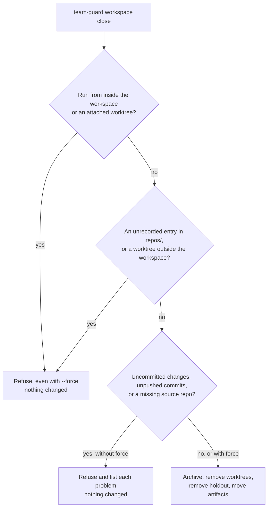

# Workspaces

A workspace gives each feature one directory for its workflow artifacts and one git worktree per repo it touches.

Workflow artifacts (spec, briefs, ADRs, `contract.md`, review reports, the decision log) live in the workspace dir, never in a project repo.
Only the project's own code, tests, and user-facing docs go in a repo.
A repo that isn't attached to a workspace behaves as it always did.

## Know the layout

```text
~/.agentic-workflow/work/payments/        workspace dir (root: TEAM_WORKSPACE_ROOT)
  workspace.json                          feature, branch, attached repos
  jev-decisions.md                        Jev decision log
  spec.md, contract.md, ...               workflow artifacts, any names you like
  repos/
    api/                                  attached worktree of ~/code/api, on feat/payments
    web/                                  attached worktree of ~/code/web, on feat/payments
~/.agentic-workflow/holdout/payments/     holdout scenarios (root: TEAM_HOLDOUT_ROOT)
~/.agentic-workflow/archive/payments/     what close keeps (root: TEAM_ARCHIVE_ROOT)
```

Each attached worktree's git admin dir sits in its source repo, at `<source>/.git/worktrees/<id>/`.
That's where its seal lock (`team-test-lock.json`) and its pointer back to the workspace (`team-workspace`) live.
Nothing is written to a source repo's config, working tree, or tracked files.

## Create a workspace

Run this from anywhere:

```bash
team-guard workspace new payments
# team-guard: created workspace payments at /Users/you/.agentic-workflow/work/payments
```

It creates the workspace dir, an empty `repos/`, and `workspace.json`.
The branch defaults to `feat/FEATURE`; pass `--branch <name>` to choose another.
Feature names start with a letter or digit and use only letters, digits, `.`, `_`, and `-`.

If other workspaces are merged or stale, `new` prints a hint to run `team-guard gc`.

## Attach repos

Run `attach` from the workspace dir, or pass `--feature` from anywhere:

```bash
cd ~/.agentic-workflow/work/payments
team-guard workspace attach ~/code/api
# team-guard: attached api at .../work/payments/repos/api on feat/payments from main
team-guard workspace attach ~/code/web --base develop
```

`attach` adds a git worktree at `repos/<repo-name>/` on the workspace branch.

- **Base:** `--base <branch>`, else the target of `origin/HEAD`, else `main`. The base is a branch name, not a remote ref.
- **Branch:** created at the base's tip. If the branch already exists and isn't checked out anywhere, `attach` reuses it.
- **Source repo:** its files, HEAD, index, and config stay untouched, and its own git hooks don't run during the checkout.

`attach` refuses a path that isn't a git repo, a bare repo, a repo already attached here, a second repo with the same name, and a branch checked out elsewhere.

Once every repo is attached, start the team from the workspace dir.
Each agent edits code inside `repos/<repo>/` and keeps artifacts in the workspace dir.

## Find the workspace

```bash
team-guard workspace-path
# /Users/you/.agentic-workflow/work/payments

team-guard workspace show
# workspace: /Users/you/.agentic-workflow/work/payments
# feature: payments
# branch: feat/payments
# repo api source=/Users/you/code/api worktree=/Users/you/.agentic-workflow/work/payments/repos/api base=main
# repo web source=/Users/you/code/web worktree=/Users/you/.agentic-workflow/work/payments/repos/web base=develop
```

Both work from the workspace dir or any attached worktree.
`workspace-path` fails elsewhere; `workspace show payments` works from anywhere.

## Seal and verify across repos

Seals are per repo, so seal, run `team-guard list`, and commit from inside an attached worktree.
Run `team-guard verify` from the workspace dir to check every attached repo at once:

```bash
cd ~/.agentic-workflow/work/payments
team-guard verify
# team-guard: all sealed tests unchanged in 2 attached repo(s)
```

The `TaskCompleted` and `SubagentStop` hooks check every attached repo too.
See [Guard rails](./guard-rails.md) for details.

## Find the holdout directory

```bash
team-guard holdout-path
# /Users/you/.agentic-workflow/holdout/payments
```

Inside a workspace, `holdout-path` creates the feature's holdout directory with a `.workspace` marker that names the workspace dir.
Outside a workspace, it falls back to `<holdout-root>/<repo>/<branch>`, with `/` in the branch replaced by `-`.
It refuses if the holdout root is inside the workspace dir.

## Check workspace status

```bash
team-guard workspace list
# payments	active	3d	1.2M
# search	merged	12d	840.0K
```

Each tab-separated line shows the feature, status, age in days, and size on disk.

| Status | Meaning |
|---|---|
| `active` | None of the below. |
| `merged` | Every attached branch is merged into its base (local or remote-tracking), or deleted. A branch with no new commits doesn't count. |
| `stale` | A source repo is missing, or nothing changed for `TEAM_STALE_DAYS` (default 30). Activity is the newest artifact change or commit on the workspace branch. |
| `invalid` | `workspace.json` is missing or isn't valid JSON. |

Pass `--stale-days <N>` to override the idle period.
A squash-merged branch isn't detected as merged, so that workspace stays `active` until it goes stale.

## Close a workspace

After you merge, close the workspace from outside it:

```bash
cd ~
team-guard workspace close payments
```

On success, `close`:

1. Copies each worktree's seal lock, and any Jev log in its git dir, to `<archive>/<repo-name>/`.
2. Lists each ignored file in each worktree as `deleting ignored: <repo>/<path>`, then removes the worktree with `git worktree remove`.
3. Removes the holdout directory, if its marker names this workspace.
4. Moves every other entry of the workspace dir into the archive, then removes the now-empty workspace dir.

The archive is `<archive-root>/<feature>/`, or `<feature>+2`, `+3`, … if that name is taken.
It also holds `workspace.json` as it was when the close started, and an `archive.json` with the close time and anything discarded.
Branches are never deleted.

### Understand what close refuses



`close` refuses, and changes nothing, when:

- **You run it from inside.** That's the workspace dir or any attached worktree, even with `--force`.
- **`repos/` has an unrecorded entry.** Any file, directory, or symlink there that `workspace.json` doesn't record blocks the close, even with `--force`.
- **A worktree isn't contained or owned.** Each recorded worktree must resolve to exactly `repos/<name>/`, and its source repo must list it as a worktree. `--force` doesn't override this either.
- **Work would be lost.** Uncommitted changes (untracked files included), commits no remote-tracking branch reaches, or a missing source repo. Each problem is listed per worktree.

Use `--force` only when that work is safe to discard.
It prints a `discarded <reason> in <worktree>` line for each item and still keeps every branch.

An ignored file, such as a local `.env`, never blocks a close.
It's listed, then deleted with the worktree, so copy anything you need first.

### Resume an interrupted close

`close` never deletes the workspace dir recursively; it removes it only once it's empty.
If a step fails, for example because a worktree is locked with `git worktree lock`, `close` stops and exits 1.
Worktrees already removed stay removed, and holdouts and artifacts are untouched until every worktree is gone.
Fix the cause and run `close` again: it resumes into the same archive.

## Collect stale workspaces

```bash
team-guard gc
# would delete archive /Users/you/.agentic-workflow/archive/onboarding (194d old)
# would remove orphan holdout /Users/you/.agentic-workflow/holdout/old-feature (no workspace)
# would close search (merged, 12d)
```

`gc` only lists what it would collect:

- Archives closed at least `TEAM_ARCHIVE_RETENTION_DAYS` ago (default 180).
- Legacy per-repo holdouts untouched for that same retention period.
- Workspace holdouts whose workspace no longer exists.
- Merged or stale workspaces, workspaces whose worktrees are all missing, and interrupted closes.

Add `--apply` to act on the list.
It closes workspaces without `--force`: one that would need it is printed as `skipped <feature>: ...` and left alone.
It asks no questions, so run `gc` without `--apply` first.
Nothing runs in the background.

Override the periods with `--stale-days <N>` and `--retention-days <R>`.

## Set the environment

| Variable | Default | Controls |
|---|---|---|
| `TEAM_WORKSPACE_ROOT` | `~/.agentic-workflow/work` | Where workspaces are created |
| `TEAM_HOLDOUT_ROOT` | `~/.agentic-workflow/holdout` | Where holdout scenarios live. Keep it outside the workspace root. |
| `TEAM_ARCHIVE_ROOT` | `~/.agentic-workflow/archive` | Where `close` archives |
| `TEAM_STALE_DAYS` | `30` | Idle days before a workspace is stale |
| `TEAM_ARCHIVE_RETENTION_DAYS` | `180` | Days before `gc` collects archives and legacy holdouts |

A command-line option beats its variable.

## Know the limits

- Workspaces are local. `team-guard` doesn't push, open PRs, or enforce the ship order across repos.
- Don't run several `team-guard` commands against one workspace at once.
- You can't detach a repo from a live workspace.
- Pushing the workflow branch from the source checkout, not the worktree, skips the worktree's `pre-push` check.
- The git hooks stay in the source repo's hooks dir after `close`. They do nothing without a lock.

## Fix common errors

| Message | What to do |
|---|---|
| `no workspace found` | Run the command from the workspace dir or an attached worktree, or pass `--feature`. |
| `the workspace pointer here is dangling` | The worktree points at a workspace dir that's gone. Check `team-guard workspace list`. |
| `can't read .../workspace.json (missing or not valid JSON)` | Restore or fix `workspace.json`. `list` and `gc` report it as `invalid` and leave it alone. |
| `branch feat/payments is already checked out in ...` | Free the branch in that checkout, or create the workspace with another `--branch`. |
| `can't close payments from inside it` | `cd` somewhere outside the workspace and rerun. |

## Next steps

- Follow the steps in [Workflow](./workflow.md).
- Learn how seals work in [Guard rails](./guard-rails.md).
