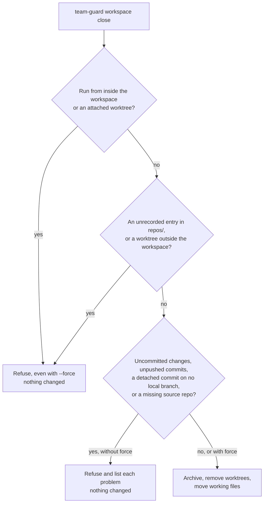

# Workspaces

A workspace gives each task one directory for the agents' working files and one git worktree per repo it touches.

The design doc, test list, review reports and follow-ups live in the workspace dir, never in a project repo.
Only the project's own code, tests, and user-facing docs go in a repo.
A repo that isn't attached to a workspace behaves as it always did.

## Know the layout

```text
~/.agentic-workflow/work/payments/        workspace dir (root: TEAM_WORKSPACE_ROOT)
  workspace.json                          feature, branch, attached repos
  design.md, tests.md, followups.md, ...  working files
  repos/
    api/                                  attached worktree of ~/code/api, on feat/payments
    web/                                  attached worktree of ~/code/web, on feat/payments
~/.agentic-workflow/archive/payments/     what close keeps (root: TEAM_ARCHIVE_ROOT)
```

Each attached worktree's git admin dir sits in its source repo, at `<source>/.git/worktrees/<id>/`.
That's where its pointer back to the workspace (`team-workspace`) lives.
Nothing is written to a source repo's config, working tree, or tracked files.

## Create a workspace

Run this from anywhere:

```bash
team-guard workspace new payments
# team-guard: created workspace payments at /Users/you/.agentic-workflow/work/payments
```

It creates the workspace dir, an empty `repos/`, and `workspace.json`.
The branch defaults to `feat/FEATURE`; pass `--branch <name>` to choose another.
Feature names start with a letter or digit and use only letters, digits, `.`, `_`, and `-`.

If other workspaces are merged or stale, `new` prints a hint to run `team-guard workspace list`.

## Attach repos

Run `attach` from the workspace dir, or pass `--feature` from anywhere:

```bash
cd ~/.agentic-workflow/work/payments
team-guard workspace attach ~/code/api
# team-guard: attached api at .../work/payments/repos/api on feat/payments from main
team-guard workspace attach ~/code/web --base develop
```

`attach` adds a git worktree at `repos/<repo-name>/` on the workspace branch.

- **Base:** `--base <branch>`, else the target of `origin/HEAD`, else `main`. The base is a branch name, not a remote ref.
- **Branch:** created at the base's tip. If the branch already exists and isn't checked out anywhere, `attach` reuses it.
- **Source repo:** its files, HEAD, index, and config stay untouched, and its own git hooks don't run during the checkout.

`attach` refuses a path that isn't a git repo, a bare repo, a repo already attached here, a second repo with the same name, and a branch checked out elsewhere.

Once every repo is attached, start the team from the workspace dir.
Each agent edits code inside `repos/<repo>/` and keeps working files in the workspace dir.

## Find the workspace

```bash
team-guard workspace-path
# /Users/you/.agentic-workflow/work/payments
team-guard workspace show
# workspace: /Users/you/.agentic-workflow/work/payments
# feature: payments
# branch: feat/payments
# repo api source=/Users/you/code/api worktree=.../repos/api base=main
```

Both work from the workspace dir or any attached worktree. `workspace-path` fails elsewhere.

## Check workspace status

```bash
team-guard workspace list
# payments	active	3d	1.2M
# search	merged	12d	840.0K
```

Each tab-separated line shows the feature, status, age in days, and size on disk.

| Status | Meaning |
|---|---|
| `active` | None of the below. |
| `merged` | Every attached branch is merged into its base (local or remote-tracking), or deleted. A branch with no new commits doesn't count. |
| `stale` | A source repo is missing, or nothing changed for `TEAM_STALE_DAYS` (default 30). |
| `invalid` | `workspace.json` is missing or isn't valid JSON. |

Pass `--stale-days <N>` to override the idle period.
A squash-merged branch isn't detected as merged, so that workspace stays `active` until it goes stale.

## Close a workspace

After you merge, close the workspace from outside it:

```bash
cd ~
team-guard workspace close payments
```

On success, `close`:

1. Lists each ignored file in each worktree as `deleting ignored: <repo>/<path>`, then removes the worktree with `git worktree remove`.
2. Moves every entry of the workspace dir into the archive, then removes the now-empty workspace dir.

The archive is `<archive-root>/<feature>/`, or `<feature>+2`, `+3`, … if that name is taken.
It also holds `workspace.json` as it was when the close started, and an `archive.json` with the close time and anything discarded.
Branches are never deleted.



Use `--force` only when the work it lists is safe to discard.
It prints a `discarded <reason> in <worktree>` line for each item and still keeps every branch.
An ignored file, such as a local `.env`, never blocks a close; it is listed, then deleted with the worktree.

If a step fails, for example because a worktree is locked with `git worktree lock`, `close` stops and exits 1.
Worktrees already removed stay removed, and working files are untouched until every worktree is gone.
Fix the cause and run `close` again: it resumes into the same archive.
`close` never deletes the workspace dir recursively; it removes it only once it's empty.

## Sign the branch

Before the first push, from the workspace dir:

```bash
team-guard sign --base origin/main
# team-guard: sign: api: signed 3 commit(s)
```

`sign` re-signs every commit from the base to HEAD in each attached repo, with your own key through your configured signer.
It refuses a dirty or mid-rebase checkout, restores the branch if anything fails, and warns when another pre-commit hook runs on every amend.
Outside a workspace, run it from the repo and pass `--base`.

With `TEAM_SANDBOX=1`, `sign` prints `team-guard: sign: skipped (TEAM_SANDBOX=1, commits stay unsigned)`, exits 0 and changes nothing. Set it only in a sandboxed workspace image (such as a Coder workspace) that has no personal signing key; commits made there stay unsigned, so the human gate still matters (in Coder Agents it is your review of the PR, which the lead opens ready for review, see [Workflow](./workflow.md)).

## Set the environment

| Variable | Default | Controls |
|---|---|---|
| `TEAM_WORKSPACE_ROOT` | `~/.agentic-workflow/work` | Where workspaces are created |
| `TEAM_ARCHIVE_ROOT` | `~/.agentic-workflow/archive` | Where `close` archives |
| `TEAM_STALE_DAYS` | `30` | Idle days before a workspace is stale |
| `TEAM_SANDBOX` | unset | `1` makes `team-guard sign` skip signing (sandboxed workspace images only) |

A command-line option beats its variable.

## Know the limits

- Workspaces are local. `team-guard` doesn't push or open PRs.
- Don't run several `team-guard` commands against one workspace at once.
- You can't detach a repo from a live workspace.

## Fix common errors

| Message | What to do |
|---|---|
| `no workspace found` | Run the command from the workspace dir or an attached worktree, or pass `--feature`. |
| `the workspace pointer here is dangling` | The worktree points at a workspace dir that's gone. Check `team-guard workspace list`. |
| `can't read .../workspace.json (missing or not valid JSON)` | Restore or fix `workspace.json`. `list` reports it as `invalid` and leaves it alone. |
| `branch feat/payments is already checked out in ...` | Free the branch in that checkout, or create the workspace with another `--branch`. |
| `detached HEAD f5661a6 is on no local branch` | Run the `git branch keep-f5661a6 ...` command it prints, then rerun `close`. `--force` discards the commit; its sha is in `archive.json`. |
| `can't close payments from inside it` | `cd` somewhere outside the workspace and rerun. |

## Next steps

- Follow the steps in [Workflow](./workflow.md).
- Install the workflow: [Harnesses](./harnesses.md).
